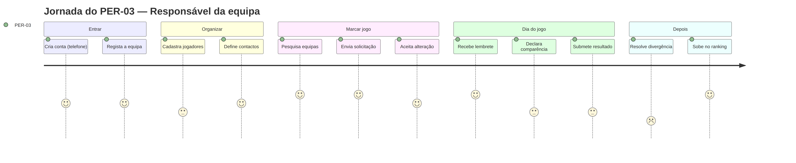
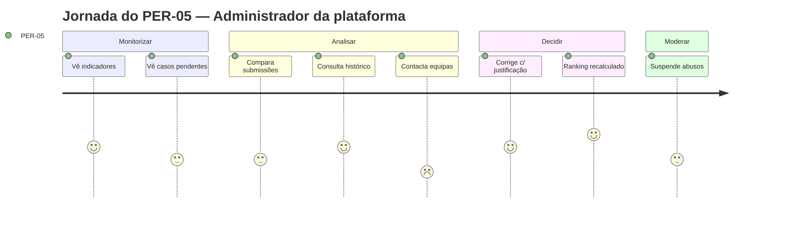

# Personas — GiraBairro

| Campo | Valor |
|-------|-------|
| Tasks | M1-03 (#17), M1-03a (#18) |
| Versão | 1.0 — 2026-11-08 |
| Estado | Rascunho para validação (M1-10) |
| Fonte | Especificação, secção 2 (Atores); [stakeholders.md](stakeholders.md) |

Os códigos **PER-0X** são usados em todos os artefactos (RF, RNF, US, casos de uso, issues — label `persona: PER-0X`).

> As personas são **arquétipos** construídos a partir dos actores da especificação. Nomes e detalhes são ilustrativos e devem ser confirmados com responsáveis de equipas reais (M1-10 / M4-06).

## Resumo

| Código | Persona | Actor da especificação | Autenticado | Gere dados |
|--------|---------|------------------------|:-----------:|-----------|
| PER-01 | Visitante | — (público) | Não | — |
| PER-02 | Utilizador registado sem equipa | Utilizador registado | Sim | O seu perfil |
| PER-03 | Responsável da equipa | Administrador/Responsável da equipa; Equipa adversária | Sim | Equipa, plantel, contactos, jogos, comparência, resultados |
| PER-04 | Responsável de contacto | Responsável de contacto | Opcional | — (no MVP é um **contacto** registado pelo PER-03, não uma conta com permissões) |
| PER-05 | Administrador da plataforma | Administrador da plataforma | Sim | Moderação, divergências, correcções auditadas |

> **Nota sobre PER-03 e "equipa adversária":** a equipa adversária não é uma persona distinta — é outro PER-03 visto do lado oposto do jogo. Cada jogo envolve **dois** PER-03 (desafiante e desafiado).

---

## PER-01 — Visitante

| | |
|---|---|
| **Exemplo** | "Nelo", 19 anos, joga numa equipa do bairro mas não é o capitão |
| **Contexto** | Telemóvel Android de gama baixa, dados móveis pré-pagos, acede por link partilhado no WhatsApp |
| **Objectivos** | Ver a posição da sua equipa no ranking; conhecer equipas de outros bairros; ver resultados |
| **Dores** | Páginas pesadas gastam dados; não quer criar conta só para ver |
| **O que faz no sistema** | TEL-01, TEL-10, TEL-11, TEL-19 (consulta) |
| **Permissões** | Leitura de informação pública: equipas, rankings, perfis públicos (contactos e plantel conforme decisões 3 e 9) |
| **RF principais** | RF-02.07, RF-02.08, RF-05.01, RF-05.02, RF-09.10 |

## PER-02 — Utilizador registado sem equipa

| | |
|---|---|
| **Exemplo** | "Dona Fátima", 42 anos, moradora que quer formar a equipa do seu quarteirão |
| **Contexto** | Telemóvel, pouca experiência com formulários longos; prefere o número de telefone ao e-mail |
| **Objectivos** | Criar conta e registar a equipa rapidamente |
| **Dores** | Esquecer a palavra-passe; registos com muitos campos |
| **O que faz no sistema** | TEL-02, TEL-03, TEL-04, TEL-21 |
| **Permissões** | Gerir o seu perfil; registar uma equipa (ao fazê-lo passa a PER-03) |
| **RF principais** | RF-01.01–RF-01.07, RF-02.01 |

## PER-03 — Responsável da equipa (persona principal)

| | |
|---|---|
| **Exemplo** | "Mister Jojó", 31 anos, capitão e organizador do "Unidos do Bairro X" há 6 anos |
| **Contexto** | Usa o telemóvel para tudo; organiza a equipa por WhatsApp; joga ao fim-de-semana; rede móvel por vezes fraca no campo |
| **Objectivos** | Arranjar jogos com equipas sérias; evitar faltas e discussões de resultado; mostrar que a equipa é boa e cumpridora (estrelas/ranking); manter o plantel organizado |
| **Dores** | Equipas que faltam sem avisar; adversários que contam outro resultado; não saber quem tem cada camisola; perder tempo a procurar contactos |
| **O que faz no sistema** | TEL-04 a TEL-18, TEL-19, TEL-20, TEL-21 |
| **Permissões** | Só sobre **a sua equipa** e **os jogos em que a sua equipa participa** (RN-02, RN-13): editar equipa, plantel e contactos; enviar/responder solicitações; cancelar jogos; declarar comparência; submeter/corrigir resultado; pedir análise |
| **RF principais** | RF-02 a RF-10 |
| **Momento crítico** | Logo a seguir ao jogo, ainda no campo: registar comparência e resultado em poucos toques |

## PER-04 — Responsável de contacto

| | |
|---|---|
| **Exemplo** | "Tio Zeca", 50 anos, dono do campo e "manager" informal da equipa; é ele quem atende as chamadas |
| **Contexto** | Pode nem ter conta no GiraBairro; o contacto dele é registado pelo PER-03 |
| **Objectivos** | Ser contactado por equipas que querem jogar; não receber chamadas de desconhecidos fora de contexto |
| **Dores** | Telefone exposto publicamente; chamadas fora de horas |
| **O que faz no sistema** | É **listado** em TEL-09/TEL-11; no MVP não tem acções próprias |
| **Permissões** | Nenhuma no MVP (extensão futura: acesso delegado — nota da secção 2 da especificação) |
| **RF principais** | RF-04.01–RF-04.06 |

## PER-05 — Administrador da plataforma

| | |
|---|---|
| **Exemplo** | "Ana", 27 anos, da equipa GiraBairro, responsável pela operação e moderação |
| **Contexto** | Computador portátil, acede diariamente ao painel |
| **Objectivos** | Manter dados fiáveis; resolver divergências de forma justa; travar abusos (contas falsas, declarações falsas) |
| **Dores** | Casos sem informação suficiente; não saber quem alterou o quê |
| **O que faz no sistema** | TEL-22 |
| **Permissões** | Consultar utilizadores e equipas; suspender/reactivar; analisar divergências; corrigir registos **com justificação auditada** (RF-11.05) |
| **RF principais** | RF-08.07, RF-11.01–RF-11.06 |

---

## Matriz persona × tela

| Tela | PER-01 | PER-02 | PER-03 | PER-05 |
|------|:-:|:-:|:-:|:-:|
| TEL-01 Página inicial | ● | ● | ● | |
| TEL-02/03 Registo / sessão | ● | ● | ● | ● |
| TEL-04 Registo da equipa | | ● | | |
| TEL-05 Dashboard | | | ● | |
| TEL-06–09 Equipa, jogadores, contactos | | | ● | |
| TEL-10/11 Pesquisa e perfil público | ● | ● | ● | ● |
| TEL-12–18 Jogos, comparência, resultados | | | ● | |
| TEL-19 Ranking | ● | ● | ● | ● |
| TEL-20 Notificações | | ● | ● | |
| TEL-21 Perfil do utilizador | | ● | ● | ● |
| TEL-22 Painel administrativo | | | | ● |

## Jornadas (M1-03a)

