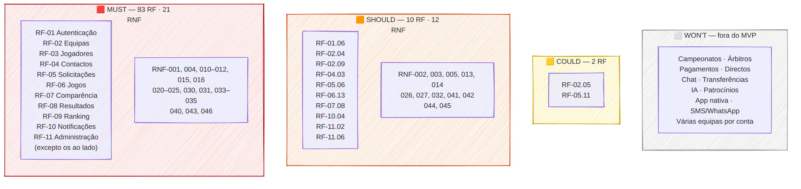

# Priorização MoSCoW — GiraBairro

| Campo | Valor |
|-------|-------|
| Tasks | M1-07 (#24), M1-07a (#25) |
| Versão | 1.0 — 2026-11-08 |
| Critério | **Must**: sem isto o princípio central (quem marcou, quem compareceu, que resultado foi confirmado) não se cumpre. **Should**: importante mas há alternativa temporária. **Could**: desejável. **Won't**: fora desta versão. |

## 1. Resumo

| | Must | Should | Could | Won't | Total |
|---|:--:|:--:|:--:|:--:|:--:|
| Requisitos funcionais | 83 | 10 | 2 | — | 95 |
| Requisitos não funcionais | 21 | 12 | 0 | — | 33 |

## 2. Must

**RF:** RF-01.01–05, 07 · RF-02.01–03, 06–08 · RF-03.01–07 · RF-04.01–02, 04–06 · RF-05.01–05, 07–10 · RF-06.01–12 · RF-07.01–07, 09 · RF-08.01–09 · RF-09.01–11 · RF-10.01–03, 05–07 · RF-11.01, 03–05

**RNF:** RNF-001, RNF-004, RNF-010, RNF-011, RNF-012, RNF-015, RNF-016, RNF-020, RNF-021, RNF-022, RNF-023, RNF-024, RNF-025, RNF-030, RNF-031, RNF-033, RNF-034, RNF-035, RNF-040, RNF-043, RNF-046

## 3. Should — e porquê não é Must

| Código | Requisito | Justificação |
|--------|-----------|--------------|
| RF-01.06 | O sistema deve permitir ao utilizador consultar e editar os seus dados básicos. | Editar dados pessoais pode ser feito por suporte nas primeiras semanas |
| RF-02.04 | O sistema deve permitir inserir o emblema da equipa, caso disponível. | O emblema melhora a identidade mas a equipa funciona sem ele |
| RF-02.09 | O sistema deve impedir a criação de duplicados evidentes, por exemplo nome da equipa e bairro iguais, sujeito à validação definida pelo sistema. | Duplicados podem ser corrigidos pelo administrador (RF-11) se escaparem |
| RF-04.03 | O responsável deve poder definir um contacto como principal. | Com vários contactos, o primeiro serve de principal por defeito |
| RF-05.06 | A equipa destinatária deve poder propor uma nova data, hora ou local. | Sem ela, a equipa recusa e a outra reenvia nova solicitação; reduz ida-e-volta mas não bloqueia |
| RF-06.13 | O sistema deve impedir o registo de resultado antes da data do jogo, exceto se o jogo for explicitamente marcado como já realizado por um administrador autorizado. | A excepção do administrador só é precisa para registos tardios |
| RF-07.08 | O sistema deve permitir consultar o histórico de comparência. | O histórico de comparência já se vê no histórico de jogos (RF-06.12) |
| RF-10.04 | O sistema deve notificar as equipas quando se aproximar a data de um jogo. | Lembrete útil, mas exige tarefa agendada; os restantes avisos cobrem o fluxo |
| RF-11.02 | O administrador deve poder suspender ou reativar contas e equipas. | Suspensões raras no piloto; podem ser feitas directamente na BD com auditoria manual |
| RF-11.06 | O administrador deve poder consultar indicadores gerais: equipas, jogadores, jogos marcados e jogos concluídos. | Indicadores gerais são úteis à gestão, não ao utilizador |

**RNF Should:** RNF-002, RNF-003, RNF-005, RNF-013, RNF-014, RNF-026, RNF-027, RNF-032, RNF-041, RNF-042, RNF-044, RNF-045

## 4. Could

| Código | Requisito | Justificação |
|--------|-----------|--------------|
| RF-02.05 | O sistema deve permitir inserir a descrição da equipa, caso disponível. | Descrição é informativa, não afecta nenhum fluxo |
| RF-05.11 | O sistema deve identificar a equipa mandante e a equipa visitante, quando aplicável. | Mandante/visitante é informativo no futebol de bairro |

## 5. Won't (fora do MVP) — justificação

| Item | Justificação |
|------|--------------|
| Campeonatos e torneios formais, inscrições | Exigem ranking e resultados fiáveis primeiro — o MVP constrói essa base |
| Árbitros e escalas de arbitragem | Dependem de campeonatos |
| Pagamentos, mensalidades, bilheteira | Integração financeira complexa; sem necessidade no fluxo de jogos amigáveis |
| Transmissão em directo | Custo de infra-estrutura e dados móveis incompatível com RNF-002 |
| Chat interno completo | Os contactos (RF-04) e o WhatsApp já cobrem a conversa |
| Mercado e transferências de jogadores | Fora do problema central (marcação e seriedade) |
| Descoberta avançada de talentos, IA e previsões | Requer volume de dados que só existe após o MVP |
| Gestão médica, equipamentos, inventário | Não contribuem para o princípio central |
| Patrocínios e publicidade, gamificação avançada | Monetização/engajamento posteriores à validação |
| Integração com calendários externos | Valor baixo face às notificações internas |
| App móvel nativa (M8, M10-05) | 1.ª versão web responsiva (RNF-010); reavaliar em M3-01 |
| Notificações por SMS/WhatsApp (excepto código de recuperação) | Decisão 10 da acta |
| Mais de uma equipa por conta | Decisão 4 da acta (RN-18) |

## 6. Impacto nas issues

As issues do backlog já seguem esta priorização: os módulos M6 e telas M7 correspondentes a requisitos Must estão com `prioridade: must`; RF-05.06 (propor alteração) e RF-10.04 (lembretes) são Should mas ficam **dentro** das issues Must M6-05 e M6-10 como critérios de aceitação de menor prioridade.
