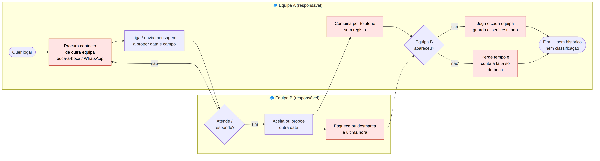
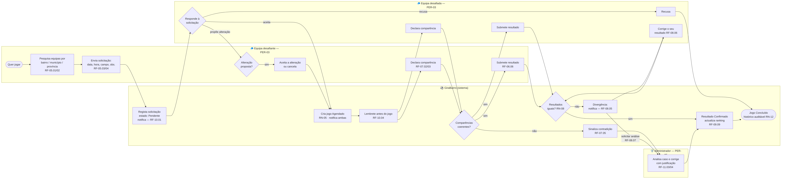

# Processos AS-IS e TO-BE — GiraBairro

| Campo | Valor |
|-------|-------|
| Task | M1-02b (#16) |
| Versão | 1.0 — 2026-11-08 |
| Notação | Fluxograma com raias (swimlanes) ao estilo BPMN, em Mermaid — fonte em `src/` |

## 1. AS-IS — como funciona hoje

Pontos de dor (a vermelho no diagrama):

| # | Passo | Dor | Resolvido no TO-BE por |
|---|-------|-----|------------------------|
| D1 | Procurar contacto de outra equipa | Depende de conhecer alguém | Pesquisa de equipas + contactos públicos (RF-02.08, RF-04.05, RF-05.01) |
| D2 | Combinar por telefone | Nada fica registado | Solicitação com estado (RF-05.04, RF-05.07) |
| D3 | Desmarcar à última hora | Sem consequência | Cancelamento com motivo + indicadores de seriedade (RF-05.09, RF-07.06) |
| D4 | Cada equipa guarda o "seu" resultado | Discussões | Confirmação bilateral (RF-06.09, RN-08) |
| D5 | Falta contada só de boca | Injustiça / sem histórico | Comparência declarada por equipa + sinalização de contradições (RF-07, RN-07) |

## 2. TO-BE — com o GiraBairro

Raias: **Equipa desafiante (PER-03)**, **GiraBairro (sistema)**, **Equipa desafiada (PER-03)**, **Administrador (PER-05)**.

| Etapa | Descrição | RF / RN |
|-------|-----------|---------|
| 1 | Pesquisa de equipas por localização | RF-02.08, RF-05.01, RF-05.02 |
| 2 | Envio da solicitação (data, hora, campo, observação) | RF-05.03, RF-05.04, RF-10.01 |
| 3 | Resposta: aceitar, recusar ou propor alteração | RF-05.05, RF-05.06, RF-10.02 |
| 4 | Jogo agendado só após aceitação | RF-05.08, RN-05 |
| 5 | Lembrete antes do jogo | RF-10.04 |
| 6 | Comparência declarada por cada equipa; contradições sinalizadas | RF-07.01–07.05, RN-06, RN-07 |
| 7 | Resultado submetido por cada equipa | RF-06.06–06.08 |
| 8 | Iguais → confirmado e ranking actualizado; diferentes → divergência | RF-06.09, RF-06.10, RF-08.02–08.05, RF-09.09 |
| 9 | Correcção pela equipa ou análise do administrador | RF-08.06, RF-08.07, RF-11.03, RF-11.04 |
| 10 | Jogo concluído com histórico auditável | RF-08.08, RN-12 |

> Pontos que dependem das decisões de M1-11: quem decide a divergência (decisão 6), se a falta exige validação (decisão 2) e se um resultado confirmado pode ser reaberto (decisão 7).
