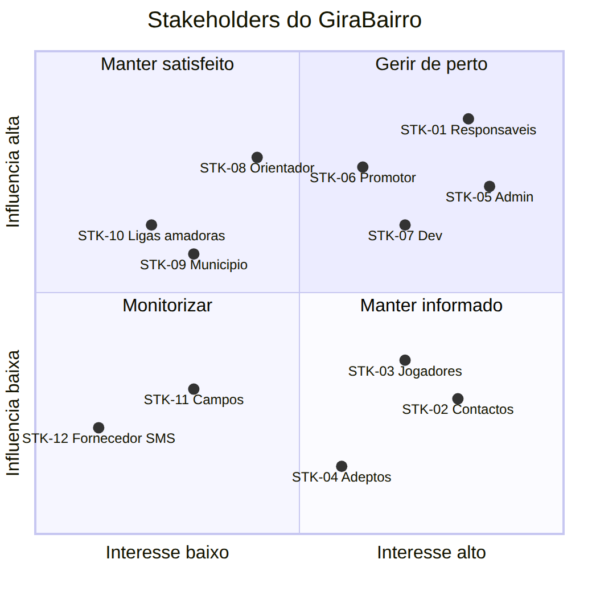

# Stakeholders — GiraBairro

| Campo | Valor |
|-------|-------|
| Tasks | M1-02 (#14), M1-02a (#15) |
| Versão | 1.0 — 2026-11-08 |
| Estado | Rascunho para validação (M1-10) |

---

## 1. Tabela de stakeholders

Escala: **Influência** e **Interesse** de 1 (baixo) a 5 (alto).

| Código | Stakeholder | Tipo | Interesse no GiraBairro | Expectativas | Influência | Interesse | Persona |
|--------|-------------|------|-------------------------|--------------|:---------:|:--------:|---------|
| STK-01 | Responsáveis / capitães de equipa | Utilizador directo | Encontrar adversários, organizar jogos, mostrar a seriedade da equipa | Registo rápido, funciona no telemóvel, poucas etapas | 5 | 5 | PER-03 |
| STK-02 | Pessoas de contacto da equipa | Utilizador directo | Receber pedidos de jogo de equipas sérias | Contacto visível só para quem interessa | 2 | 4 | PER-04 |
| STK-03 | Jogadores | Utilizador indirecto | Ver o plantel, jogos e posição da equipa no ranking | Privacidade do nome; estar no plantel correcto | 2 | 4 | PER-01 / PER-02 |
| STK-04 | Adeptos e moradores do bairro | Utilizador indirecto | Acompanhar a equipa do bairro e os rankings | Informação pública e actualizada | 1 | 3 | PER-01 |
| STK-05 | Administradores da plataforma | Operação | Manter dados fiáveis, resolver divergências, moderar | Painel com casos pendentes; histórico auditável | 4 | 5 | PER-05 |
| STK-06 | Promotor / dono do produto (GeniusLemos) | Patrocinador | Lançar o MVP e validar a adesão | Entrega dentro do âmbito; métricas de uso | 5 | 5 | — |
| STK-07 | Equipa de desenvolvimento | Execução | Construir o sistema com requisitos claros | Requisitos estáveis, decisões tomadas a tempo | 4 | 4 | — |
| STK-08 | Orientador / avaliador académico | Validação | Qualidade do processo de engenharia | Artefactos completos e rastreáveis | 4 | 3 | — |
| STK-09 | Administração municipal / comissões de moradores | Externo | Organização do desporto local, uso de campos | Possível parceria; dados agregados | 3 | 2 | — |
| STK-10 | Associações / ligas de futebol amador | Externo | Futuras competições (fora do MVP) | Ranking credível como base para torneios | 3 | 2 | — |
| STK-11 | Gestores / donos de campos | Externo | Ocupação dos campos | Saber onde e quando há jogos | 2 | 2 | — |
| STK-12 | Fornecedor de SMS/WhatsApp | Fornecedor | Venda do serviço | Integração e volume de mensagens | 2 | 1 | — |

## 2. Estratégia por quadrante

| Quadrante | Stakeholders | Estratégia |
|-----------|--------------|-----------|
| **Gerir de perto** (influência alta, interesse alto) | STK-01, STK-05, STK-06, STK-07 | Envolver na validação de requisitos (M1-10) e do protótipo (M4-06); piloto (M9-05) |
| **Manter satisfeito** (influência alta, interesse baixo) | STK-08, STK-09, STK-10 | Relatórios de progresso; apresentar ranking e processo |
| **Manter informado** (influência baixa, interesse alto) | STK-02, STK-03, STK-04 | Comunicação no lançamento; recolher feedback no piloto |
| **Monitorizar** (influência baixa, interesse baixo) | STK-11, STK-12 | Contacto pontual quando necessário |

## 3. Mapa influência × interesse (M1-02a)

*Fonte: [`src/stakeholders.mmd`](src/stakeholders.mmd)*
