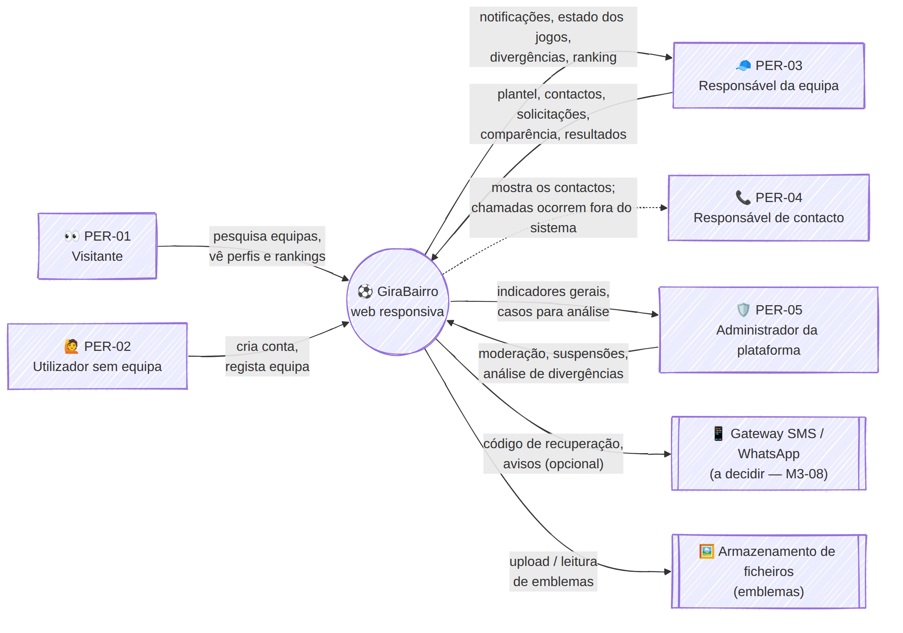

# Documento de Visão — GiraBairro

| Campo | Valor |
|-------|-------|
| Task | M1-01 (#12) |
| Versão | 1.0 — 2026-11-08 |
| Estado | ✅ Validado (M1-10, 2026-11-08) |
| Fonte | [`GiraBairro_MVP_Requisitos_Funcionais_Telas.md`](../../GiraBairro_MVP_Requisitos_Funcionais_Telas.md) |

---

## 1. Problema

O futebol comunitário (equipas de bairro) organiza-se hoje de forma **informal**:

| # | Problema | Consequência |
|---|----------|--------------|
| P1 | Para marcar um jogo é preciso conhecer alguém da outra equipa; os contactos circulam de boca em boca ou em grupos de WhatsApp. | Equipas novas ou de outros bairros têm dificuldade em encontrar adversários. |
| P2 | A marcação (data, hora, campo) fica em mensagens e chamadas sem registo. | Mal-entendidos sobre o que foi combinado; jogos desmarcados à última hora. |
| P3 | Faltas de comparência não deixam rasto. | Não há forma de distinguir equipas sérias de equipas que faltam com frequência. |
| P4 | O resultado depende da palavra de cada equipa. | Discussões sobre o marcador; cada equipa conta a "sua" versão. |
| P5 | Não existe histórico nem classificação. | As equipas não conseguem mostrar o seu valor nem comparar-se com as do bairro, município ou província. |
| P6 | O plantel (jogadores, números, posições) vive em papel ou na memória do responsável. | Difícil gerir camisolas repetidas e jogadores inactivos. |

## 2. Proposta de valor

> **GiraBairro** é uma plataforma web (responsiva, pensada para telemóvel) onde cada equipa de bairro tem o seu perfil, plantel e contactos, **marca jogos com outras equipas**, **regista quem compareceu** e **confirma o resultado com a adversária** — alimentando um **ranking local** que premia as vitórias e a **seriedade**.

**Princípio central:** registar de forma clara e auditável **quem marcou** o jogo, **quem compareceu** e **qual resultado foi confirmado por ambas as equipas**.

## 3. Público-alvo

| Grupo | Papel no MVP | Persona (M1-03) |
|-------|--------------|-----------------|
| Visitantes (adeptos, jogadores, curiosos) | Consultam equipas e rankings públicos | PER-01 |
| Pessoas com conta, ainda sem equipa | Registam uma equipa | PER-02 |
| Responsáveis / capitães de equipa | Gerem equipa, plantel, contactos, jogos, comparência e resultados | PER-03 |
| Pessoas de contacto da equipa | Recebem chamadas de outras equipas para marcar jogos | PER-04 |
| Administração da plataforma | Moderação, suspensões, análise de divergências | PER-05 |

## 4. Objectivos do MVP

| Código | Objectivo | Indicador de sucesso (proposta) |
|--------|-----------|-------------------------------|
| OBJ-01 | Facilitar a descoberta e o contacto entre equipas | ≥ 70 % das solicitações enviadas a equipas descobertas pela pesquisa |
| OBJ-02 | Permitir marcar e gerir jogos entre equipas | ≥ 60 % das solicitações respondidas em 48 h |
| OBJ-03 | Registar jogadores, números e posições | Equipas activas com ≥ 11 jogadores registados |
| OBJ-04 | Registar a comparência de cada equipa | ≥ 80 % dos jogos com comparência declarada pelas duas equipas |
| OBJ-05 | Confirmar resultados pelas duas equipas | ≥ 80 % dos jogos concluídos com resultado confirmado; < 10 % divergentes |
| OBJ-06 | Ranking por localização com vitórias e seriedade | Ranking publicado por bairro, município e província |

## 5. Âmbito do MVP

Módulos (correspondência com a especificação, secção 3):

| Módulo | RF |
|--------|----|
| Contas e autenticação (telefone + palavra-passe) | RF-01 |
| Equipas (registo, perfil público, pesquisa) | RF-02 |
| Plantel / jogadores | RF-03 |
| Contactos para marcação | RF-04 |
| Descoberta e solicitação de jogos | RF-05 |
| Gestão de jogos | RF-06 |
| Comparência e seriedade | RF-07 |
| Confirmação de resultados e divergências | RF-08 |
| Ranking e estrelas | RF-09 |
| Notificações internas | RF-10 |
| Administração básica | RF-11 |

Fluxo principal suportado:

```
Criar conta → Registar equipa → Plantel + contactos → Pesquisar adversário → Solicitar jogo
→ Aceitar / recusar / propor alteração → Jogo agendado → Comparência (cada equipa)
→ Resultado (cada equipa) → Confirmado ou divergente (→ análise) → Ranking actualizado
```

## 6. Fora do âmbito do MVP

Campeonatos e torneios formais · inscrições em campeonatos · árbitros e escalas · pagamentos, mensalidades e bilheteira · transmissão em directo · chat interno completo · mercado/transferências de jogadores · descoberta avançada de talentos · IA e previsões · gestão médica · equipamentos e inventário · patrocínios e publicidade · gamificação avançada · integração com calendários externos · **app móvel nativa** (a 1.ª versão é web responsiva).

> Estes pontos vêm da ideia original (README) e ficam como **visão de longo prazo**: o MVP cria a base (equipas, jogos, resultados confiáveis) sobre a qual campeonatos e arbitragem podem ser construídos.

## 7. Restrições e pressupostos

| Tipo | Descrição |
|------|-----------|
| Pressuposto | A maioria dos responsáveis usa **telemóvel Android** com dados móveis, por vezes lentos ou caros. |
| Pressuposto | O **número de telefone** é o identificador natural das pessoas (mais do que o e-mail). |
| Pressuposto | A divisão territorial usada é **Província › Município › Bairro** (Angola). |
| Restrição | A 1.ª versão é **web responsiva**; app nativa só após decisão em M3-01. |
| Restrição | Notificações do MVP são **internas**; SMS/WhatsApp dependem da decisão 10 (M1-11). |
| Restrição | Dados pessoais (telefones, nomes de jogadores) exigem cuidado de visibilidade (decisões 3 e 9). |

## 8. Riscos principais

| Risco | Impacto | Mitigação |
|-------|---------|-----------|
| Equipas não registam comparência/resultado após o jogo | Ranking pouco fiável | Lembretes (RF-10.04/05); só resultados confirmados contam |
| Declarações falsas de falta da adversária | Injustiça no ranking | RN-07: declaração unilateral não confirma falta; análise do admin |
| Pouca adesão inicial (efeito rede) | Pesquisa vazia | Piloto num bairro/município (M9-05); registo simples |
| Custo/fiabilidade de SMS para recuperação de palavra-passe | Bloqueio de contas | Spike M3-08 |

## 9. Diagrama de contexto



*(ver M1-01a — fonte em `src/contexto.mmd`)*

## 10. Decisões em aberto

As 10 decisões da secção 9 da especificação são tratadas em [`../00-gestao/actas/decisoes-mvp.md`](../00-gestao/actas/decisoes-mvp.md) (M1-11) e a fórmula de ranking/estrelas em [`regras-negocio.md`](regras-negocio.md) (M1-12).
