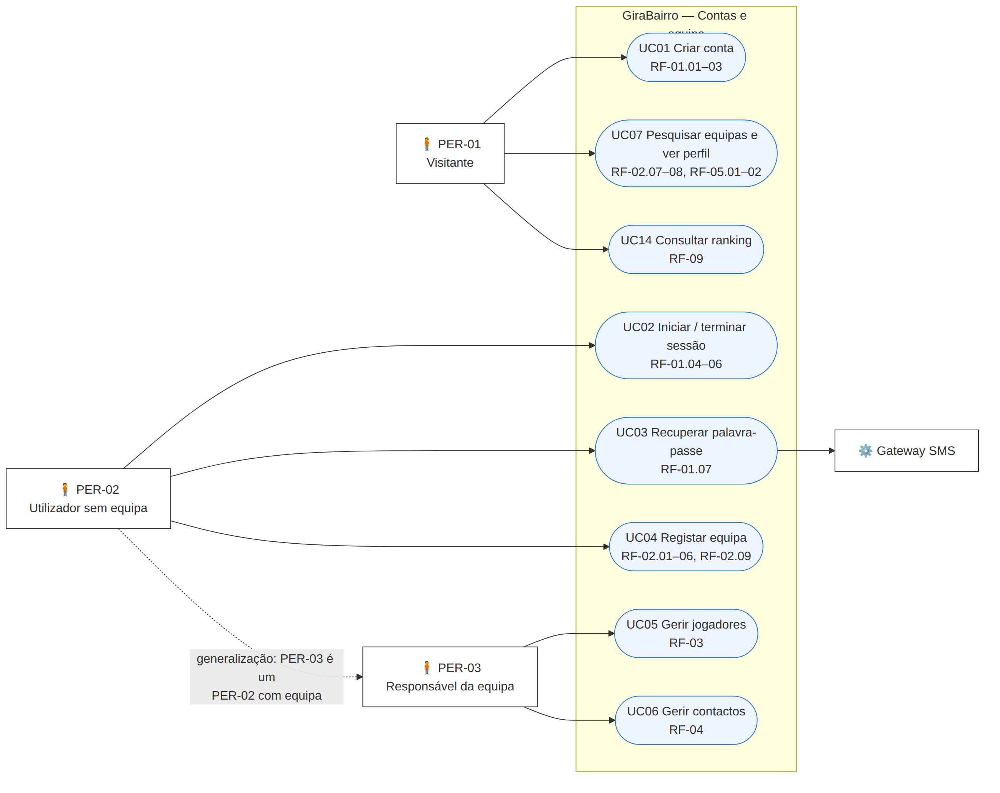
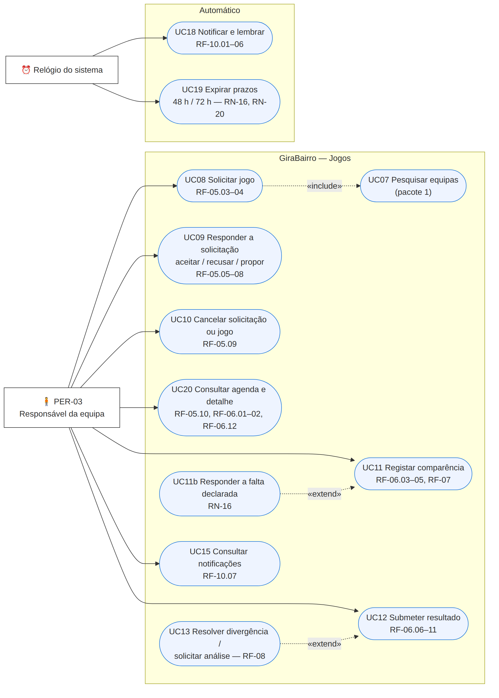
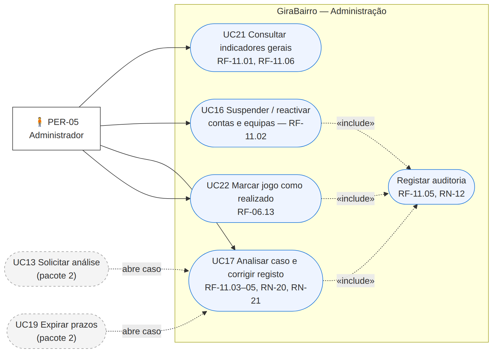

# Casos de Uso — GiraBairro

| Campo | Valor |
|-------|-------|
| Task | M2-01 (#29) |
| Versão | 1.0 — 2026-11-08 |
| Actores | PER-01, PER-02, PER-03, PER-05 ([personas](../../01-requisitos/personas.md)); Gateway SMS; Relógio do sistema |
| Notação | UML de casos de uso em Mermaid (actores = rectângulos, casos de uso = elipses, `«include»`/`«extend»` a tracejado) |

> O PER-04 (responsável de contacto) não é actor: no MVP é apenas um contacto registado pelo PER-03 (ver personas). O diagrama foi dividido em **3 pacotes** para ficar legível em A4.

## Pacote 1 — Contas e equipa

## Pacote 2 — Jogos, comparência e resultados

## Pacote 3 — Administração

## Catálogo

| UC | Nome | Actor principal | RF | US | Prioridade | Especificado em M2-02 |
|----|------|-----------------|----|----|:---------:|:---:|
| UC01 | Criar conta | PER-01/02 | RF-01.01–03 | US-001 | Must | ✅ |
| UC02 | Iniciar / terminar sessão (e editar perfil) | PER-02/03/05 | RF-01.04–06 | US-002, US-004 | Must | |
| UC03 | Recuperar palavra-passe | PER-02/03 | RF-01.07 | US-003 | Must | ✅ |
| UC04 | Registar e editar equipa | PER-02/03 | RF-02.01–06, 02.09 | US-005, US-006 | Must | ✅ |
| UC05 | Gerir jogadores | PER-03 | RF-03 | US-008, US-009 | Must | |
| UC06 | Gerir contactos | PER-03 | RF-04.01–04 | US-010 | Must | |
| UC07 | Pesquisar equipas e ver perfil | PER-01/03 | RF-02.07–08, 04.05–06, 05.01–02 | US-007, US-011 | Must | |
| UC08 | Solicitar jogo | PER-03 | RF-05.03–04, 05.11 | US-012 | Must | ✅ |
| UC09 | Responder a solicitação | PER-03 | RF-05.05–08 | US-013, US-014 | Must | ✅ |
| UC10 | Cancelar solicitação ou jogo | PER-03 | RF-05.09 | US-015 | Must | ✅ |
| UC11 | Registar comparência | PER-03 | RF-06.03–05, RF-07 | US-017, US-018, US-019 | Must | ✅ |
| UC11b | Responder a falta declarada | PER-03 | RF-07.05, 07.09 | US-018 | Must | ✅ |
| UC12 | Submeter resultado | PER-03 | RF-06.06–11, RF-08.01–04 | US-020, US-021 | Must | ✅ |
| UC13 | Resolver divergência / solicitar análise | PER-03 | RF-08.05–09 | US-022 | Must | ✅ |
| UC14 | Consultar ranking | PER-01/03 | RF-09 | US-023, US-024 | Must | ✅ |
| UC15 | Consultar notificações | PER-03 | RF-10.07 | US-026 | Must | |
| UC16 | Suspender / reactivar | PER-05 | RF-11.02 | US-029 | Should | |
| UC17 | Analisar caso e corrigir registo | PER-05 | RF-11.03–05 | US-030 | Must | ✅ |
| UC18 | Notificar e lembrar (automático) | Relógio | RF-10.01–06 | US-026, US-027 | Must | |
| UC19 | Expirar prazos 48 h / 72 h (automático) | Relógio | RN-16, RN-20 | US-018, US-022 | Must | ✅ |
| UC20 | Consultar agenda e detalhe do jogo | PER-03 | RF-05.10, 06.01–02, 06.12 | US-016, US-025 | Must | |
| UC21 | Consultar indicadores gerais | PER-05 | RF-11.01, 11.06 | US-028 | Must | |
| UC22 | Marcar jogo como realizado | PER-05 | RF-06.13 | US-031 | Should | |
