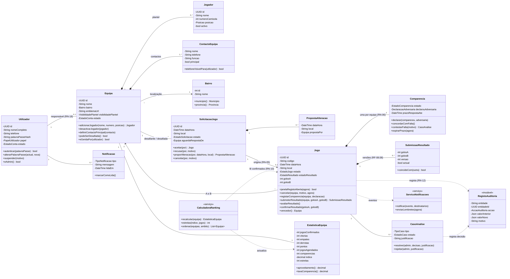

# Diagrama de Classes — GiraBairro

| Campo | Valor |
|-------|-------|
| Task | M2-06 (#34) |
| Versão | 1.0 — 2026-11-08 |
| Base | [MER](../mer/README.md), [regras de negócio](../../01-requisitos/regras-negocio.md), [casos de uso](../casos-de-uso/README.md) |

*Fonte: [`../src/diagrama-classes.mmd`](../src/diagrama-classes.mmd)*

## Regras de negócio nos métodos

| Regra | Classe.método | Comportamento |
|-------|---------------|---------------|
| RN-04 | `Equipa.adicionarJogador` | Lança erro se o número já pertence a um jogador activo |
| RN-05 | `SolicitacaoJogo.aceitar` | Única forma de criar um `Jogo` |
| RN-06 | `Jogo.registarComparencia` | Altera só a `Comparencia` da equipa indicada |
| RN-07 / RN-16 | `Comparencia.declarar` / `contestarFalta` / `expirarPrazo` | A falta declarada da adversária só passa a confirmada por concordância ou expiração; contestação gera `CasoAnalise` |
| RN-08 | `Jogo.avaliarResultado` + `SubmissaoResultado.coincideCom` | Confirma apenas se as submissões actuais das duas equipas coincidem |
| RN-09 / RN-10 | `CalculadoraRanking.recalcular` | Só lê jogos com `estadoResultado = confirmado` |
| RN-11 / RN-14 / RN-15 | `CalculadoraRanking.estrelas` / `ordenar` | Fórmula do índice, "Nova" se J < 3, critérios de desempate |
| RN-12 | `Jogo`, `CasoAnalise` → `RegistoAuditoria` | Toda a alteração gera um registo imutável |
| RN-13 | `Equipa.eGeridaPor` | Verificado antes de qualquer operação de escrita |
| RN-17 | `ContactoEquipa.telefoneVisivelPara` | Falso para visitantes |
| RN-19 | `Equipa.podeSerDesafiada` | Falso se suspensa |
| RN-20 / RN-21 | `CasoAnalise.resolver` → `Jogo.confirmarResultado` | Exige justificação; reabertura só por admin |
| RN-23 | `Jogo.janelaRegistoAberta` | Verdadeiro entre a hora do jogo e +7 dias (ou `realizadoAdmin`) |
| RN-24 | `Jogo.cancelar` | Se faltar < 24 h, marca falta confirmada da equipa que cancela |

## Notas de desenho

- **Agregado `Jogo`**: `Comparencia` e `SubmissaoResultado` são compostas no `Jogo` (só existem dentro dele) e são alteradas apenas através dos seus métodos, para manter as invariantes.
- **Serviços** (`CalculadoraRanking`, `ServicoNotificacoes`) não guardam estado; reagem a eventos do domínio (resultado confirmado, falta confirmada, jogo cancelado).
- Enumerações: ver o [dicionário de dados](../dicionario-dados.md#enumerações).
