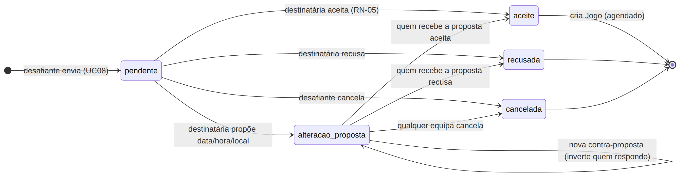
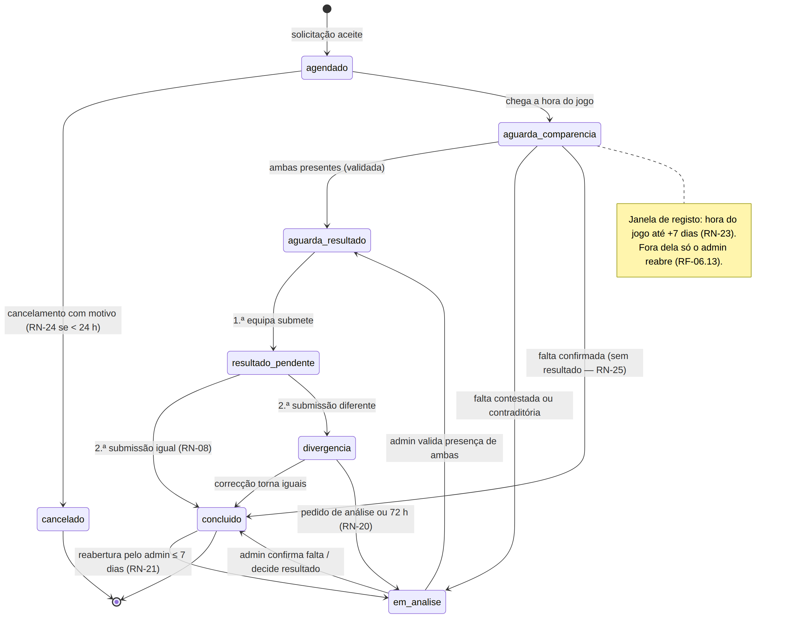
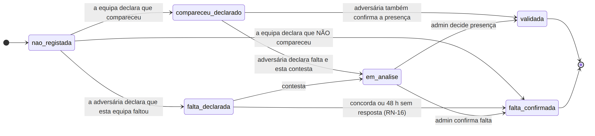
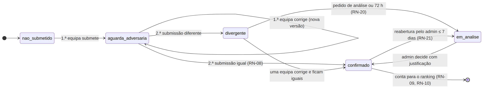

# Diagramas de Estados — GiraBairro

| Campo | Valor |
|-------|-------|
| Task | M2-08 (#36) |
| Versão | 1.0 — 2026-11-08 |
| Base | Especificação §7 (Estados essenciais), [RN](../../01-requisitos/regras-negocio.md), [dicionário — enums](../dicionario-dados.md#enumerações) |

> Prioridade subida de *Could* para *Should*: os estados são o núcleo do GiraBairro. Os nomes dos estados são **exactamente** os valores dos enums do dicionário de dados.

## 1. Solicitação de jogo (`estado_solicitacao`)

## 2. Jogo (`estado_jogo`)

## 3. Comparência de cada equipa (`estado_comparencia`)

## 4. Resultado oficial (`estado_resultado`)

## Relação entre as máquinas

| Evento | Solicitação | Jogo | Comparência (cada equipa) | Resultado |
|--------|-------------|------|---------------------------|-----------|
| Aceitação | `aceite` | criado `agendado` | `nao_registada` | `nao_submetido` |
| Chega a hora | — | `aguarda_comparencia` | (abre a janela RN-23) | — |
| Ambas presentes | — | `aguarda_resultado` | `validada` | — |
| 1.ª submissão | — | `resultado_pendente` | — | `aguarda_adversaria` |
| Submissões iguais | — | `concluido` | — | `confirmado` → ranking |
| Submissões diferentes | — | `divergencia` | — | `divergente` |
| Análise | — | `em_analise` | `em_analise` (se for de comparência) | `em_analise` (se for de resultado) |
| Falta confirmada | — | `concluido` (sem pontos — RN-25) | `falta_confirmada` | `nao_submetido` |
