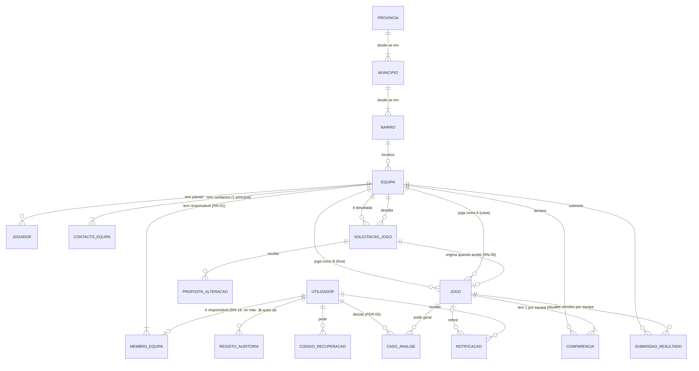
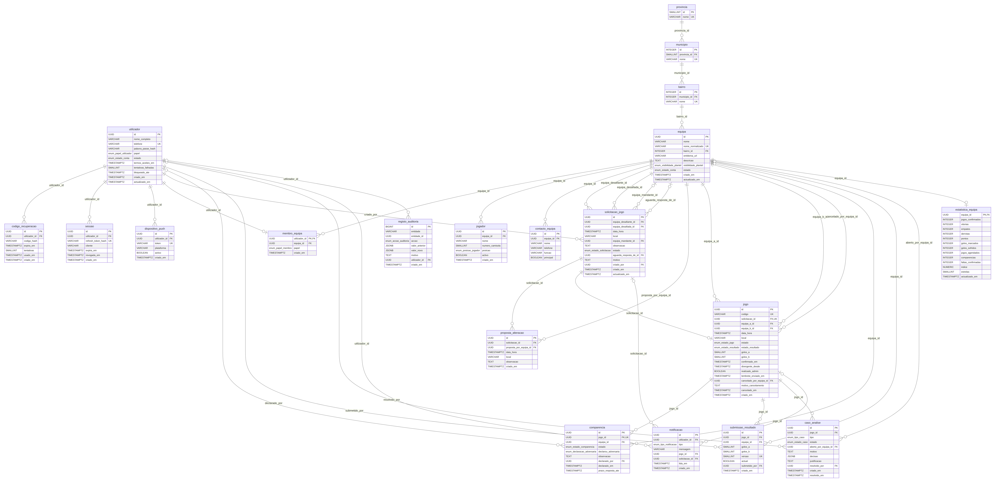

# Modelo Entidade-Relacionamento — GiraBairro

| Campo | Valor |
|-------|-------|
| Tasks | M2-03 (#31) conceptual · M2-04 (#32) lógico · M2-05 (#33) dicionário |
| Versão | 1.0 — 2026-11-08 |

## 1. MER conceptual (M2-03)

*Fonte: [`../src/mer-conceptual.mmd`](../src/mer-conceptual.mmd)*

### Entidades

| Entidade | Descrição | RF / RN |
|----------|-----------|---------|
| PROVINCIA, MUNICIPIO, BAIRRO | Divisão territorial usada na localização das equipas e nos rankings | RF-02.03, RF-09.02 |
| UTILIZADOR | Pessoa com conta (telefone único); papel `utilizador` ou `admin` | RF-01, RF-11 |
| MEMBRO_EQUIPA | Liga utilizador ↔ equipa com papel `responsavel`. Existe como entidade para permitir N equipas no futuro; no MVP um utilizador tem no máximo 1 (RN-18) | RN-01, RN-18 |
| EQUIPA | Equipa de bairro; estado `activa`/`suspensa`; visibilidade do plantel | RF-02, RN-22 |
| JOGADOR | Jogador do plantel (nome, nº, posição, activo) | RF-03, RN-03, RN-04 |
| CONTACTO_EQUIPA | Pessoas a contactar para marcar jogos; uma é principal | RF-04, RN-17 |
| SOLICITACAO_JOGO | Pedido de jogo entre duas equipas, com estado | RF-05, RN-05 |
| PROPOSTA_ALTERACAO | Cada contra-proposta de data/hora/local numa solicitação | RF-05.06 |
| JOGO | Jogo agendado (criado quando a solicitação é aceite); equipas A e B; estado do jogo e do resultado oficial | RF-06, RF-05.09–11 |
| COMPARENCIA | Declaração de comparência de **cada** equipa num jogo (2 por jogo); inclui a declaração sobre a adversária e o prazo de resposta | RF-07, RN-06, RN-07, RN-16 |
| SUBMISSAO_RESULTADO | Cada versão do marcador submetida por uma equipa (histórico) | RF-06.06–11, RF-08.08 |
| CASO_ANALISE | Caso para o administrador: divergência de resultado, comparência contestada/contraditória, reabertura | RF-08.07, RF-11.03–04, RN-20, RN-21 |
| NOTIFICACAO | Notificação interna para um utilizador, opcionalmente ligada a um jogo/equipa | RF-10 |
| REGISTO_AUDITORIA | Histórico imutável de alterações (quem, quando, antes/depois, motivo) | RN-12, RF-11.05 |
| CODIGO_RECUPERACAO | Código OTP para redefinir palavra-passe | RF-01.07, RNF-025 |

### Decisões de modelação

1. **Comparência e resultado são guardados por equipa** (nunca um único campo partilhado) — é isto que torna possível a confirmação bilateral (RN-06, RN-08).
2. O **resultado oficial** fica no JOGO só quando confirmado (por coincidência ou decisão do admin); as submissões ficam em SUBMISSAO_RESULTADO como histórico.
3. **Estatísticas e ranking** são **derivados** (não são entidades conceptuais); no modelo lógico existe uma tabela de cache `estatistica_equipa` recalculada (RNF-005).
4. Suspensões ficam no **estado** de UTILIZADOR/EQUIPA com o motivo em REGISTO_AUDITORIA.

## 2. Modelo lógico/físico (M2-04)

*Gerado por [`scripts/modelo_dados.py`](../../../scripts/modelo_dados.py) → [`../src/mer-logico.mmd`](../src/mer-logico.mmd). Abrir a imagem em tamanho real (7674 px) ou o SVG para ler os atributos.*

Resumo: **20 tabelas, 165 atributos** (`sessao` e `dispositivo_push` acrescentadas em M3-05). Pontos principais:

| Regra | Como é garantida no modelo |
|-------|----------------------------|
| Telefone único (RF-01.03) | `utilizador.telefone` UK |
| Uma equipa por utilizador (RN-18) | `membro_equipa.utilizador_id` é PK |
| Sem duplicados de equipa (RF-02.09) | UK `(nome_normalizado, bairro_id)` |
| Nº de camisola único entre activos (RN-04) | Índice único parcial `(equipa_id, numero_camisola) WHERE activo` |
| 1 contacto principal (RF-04.03) | Índice único parcial `(equipa_id) WHERE principal` |
| Jogo só após aceitação (RN-05) | `jogo.solicitacao_id` NOT NULL + UK |
| Comparência por equipa (RN-06) | `comparencia` UK `(jogo_id, equipa_id)` |
| Histórico de submissões (RF-08.08) | `submissao_resultado.versao` + `actual` |
| Prazos 48 h / 72 h (RN-16, RN-20) | `comparencia.prazo_resposta_ate`, `jogo.divergente_desde` |
| Auditoria imutável (RN-12, RNF-031) | `registo_auditoria` só INSERT |
| Ranking rápido (RNF-005) | `estatistica_equipa` (cache recalculada) |

Detalhe de cada atributo: [dicionário de dados](../dicionario-dados.md) (M2-05).
