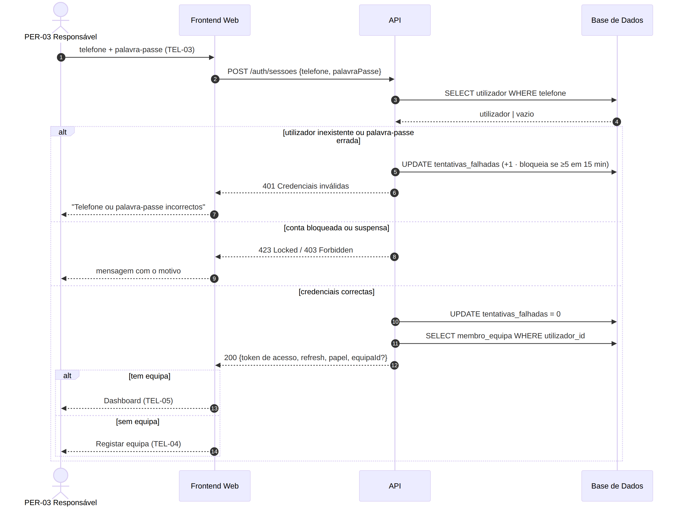
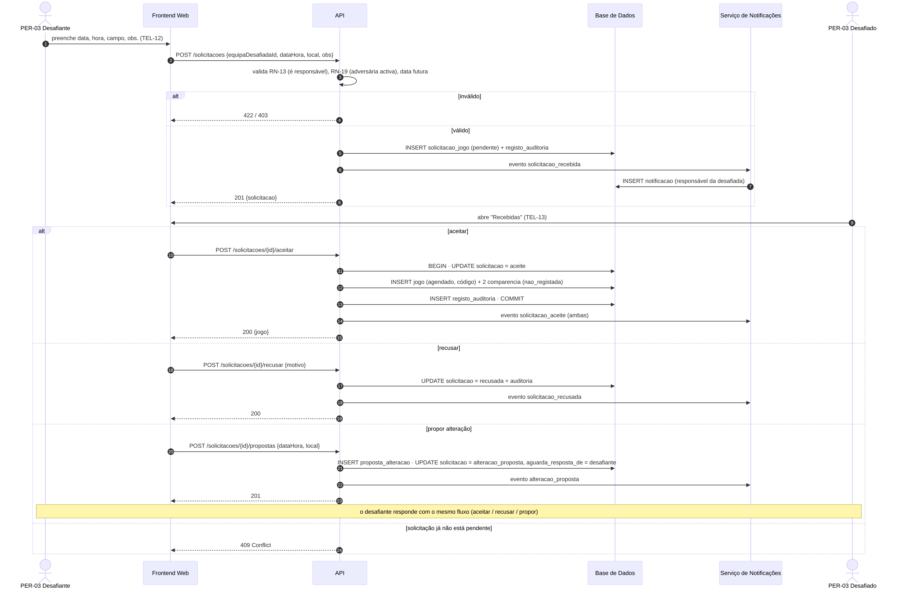
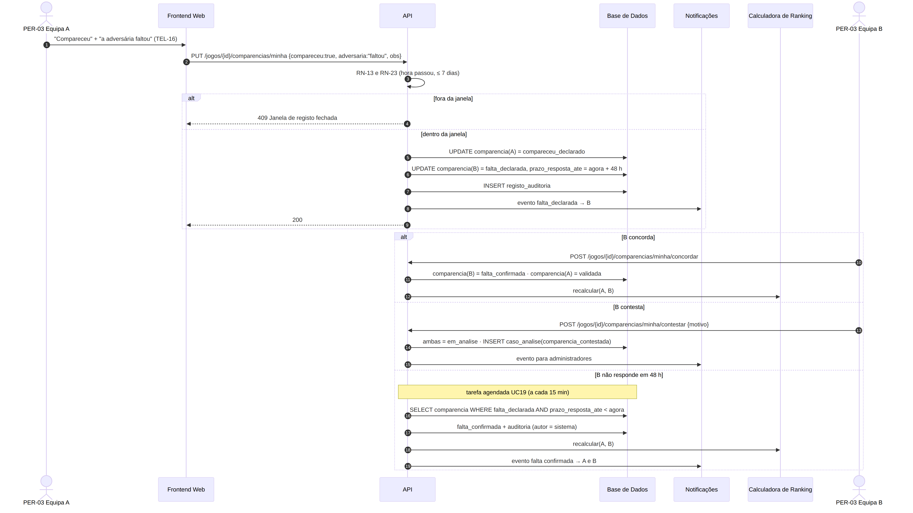
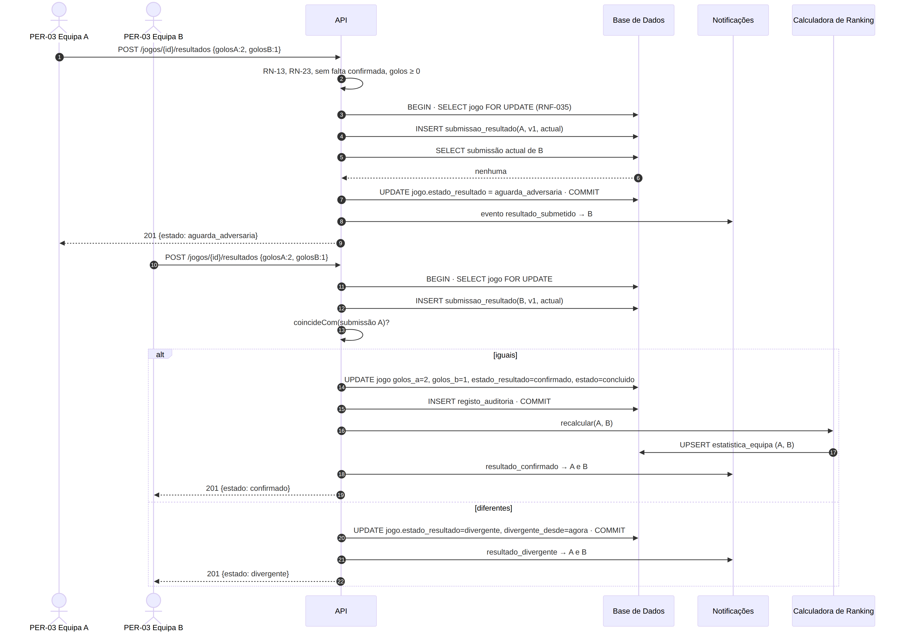
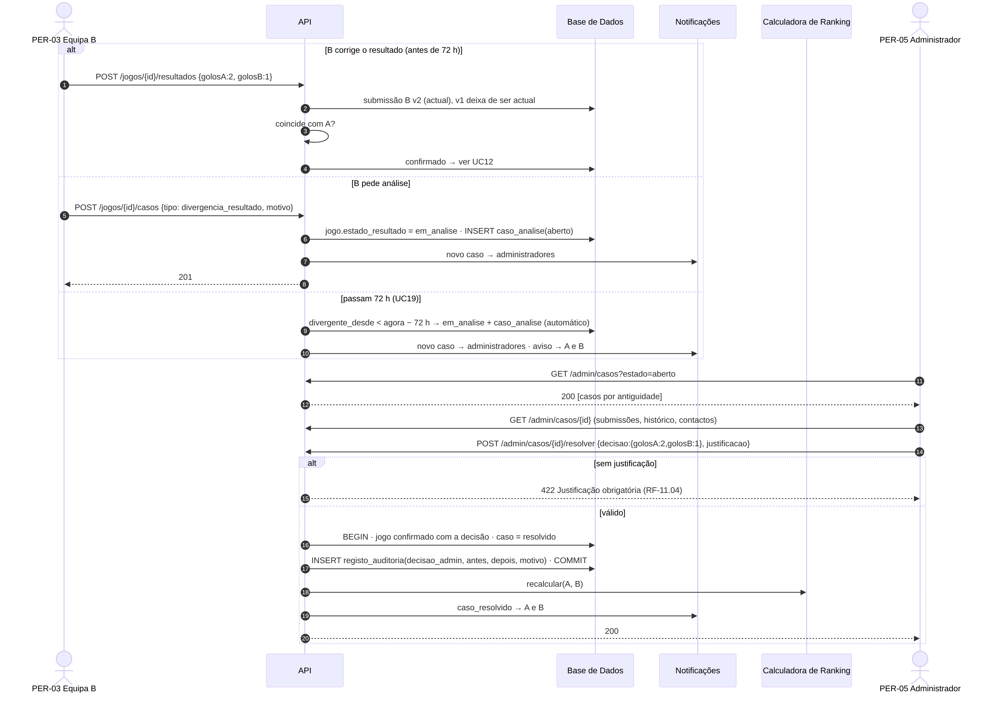

# Diagramas de Sequência — GiraBairro

| Campo | Valor |
|-------|-------|
| Task | M2-07 (#35) |
| Versão | 1.0 — 2026-11-08 |
| Base | [Especificação dos UC](../casos-de-uso/especificacao-casos-uso.md), [classes](../diagrama-classes/README.md), [dicionário](../dicionario-dados.md) |

> Endpoints alinhados com o contrato [`openapi.yaml`](../../03-arquitetura/openapi.yaml) (M3-05); diferenças de nome nas sequências (ex.: `POST /auth/sessoes`) seguem o contrato. Códigos HTTP: 200 OK · 201 Criado · 401 Não autenticado · 403 Proibido (RN-13/suspensão) · 409 Conflito de estado · 422 Validação · 423 Bloqueado.

| # | Caso de uso | Diagrama | Fonte |
|---|-------------|----------|-------|
| 1 | UC02 Iniciar sessão |  | [`.mmd`](../src/sequencia-login-UC02.mmd) |
| 2 | UC08 + UC09 Solicitar e responder |  | [`.mmd`](../src/sequencia-solicitacao-UC08-UC09.mmd) |
| 3 | UC11 + UC11b + UC19 Comparência e prazo de 48 h |  | [`.mmd`](../src/sequencia-comparencia-UC11.mmd) |
| 4 | UC12 Resultado bilateral |  | [`.mmd`](../src/sequencia-resultado-UC12.mmd) |
| 5 | UC13 + UC17 Divergência e análise |  | [`.mmd`](../src/sequencia-divergencia-UC13-UC17.mmd) |

## Pontos técnicos que saem destes diagramas (para M3)

- **Transacções com bloqueio de linha** (`SELECT … FOR UPDATE`) ao submeter resultados e ao aceitar solicitações, para evitar estados inconsistentes com submissões simultâneas (RNF-035).
- **Eventos de domínio** → serviço de notificações e recálculo do ranking (pode ser síncrono no MVP; assíncrono se RNF-005 o exigir).
- **Tarefa agendada** a cada 15 min para os prazos de 48 h / 72 h e lembretes (UC19, UC18).
- **Auditoria** dentro da mesma transacção da alteração (RN-12).
