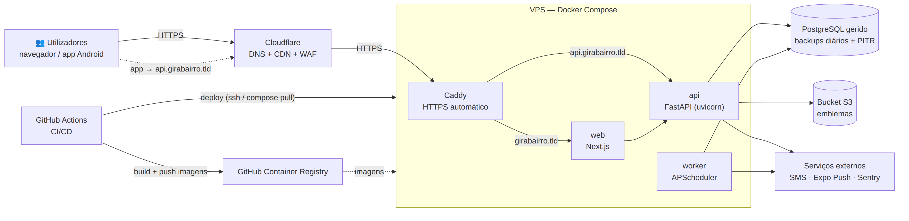

# Ambientes e Variáveis — GiraBairro

| Campo | Valor |
|-------|-------|
| Task | M3-07 (#44) |
| Versão | 1.0 — 2026-11-08 |
| Base | [stack.md](stack.md), [arquitetura.md](arquitetura.md), [seguranca.md](seguranca.md) |

## 1. Ambientes

| | **dev** (local) | **staging** | **prod** |
|---|---|---|---|
| Objectivo | Desenvolvimento e testes | Homologação (M9-05), testes E2E, demonstrações | Utilizadores reais |
| Como sobe | `docker compose up` | Deploy automático a cada merge em `develop` (M10-01) | Deploy manual aprovado a partir de uma tag `vX.Y.Z` em `master` (M10-04) |
| Web | `next dev` (porta 3000) | Contentor `web` | Contentor `web` (2 réplicas quando necessário) |
| API + worker | `uvicorn --reload` (8000) + worker | Contentores `api`, `worker` | Contentores `api` (≥ 2), `worker` (1) |
| BD | PostgreSQL em contentor | PostgreSQL em contentor com volume + backup diário | **PostgreSQL gerido** (backups automáticos, PITR) — RNF-033 |
| Ficheiros | MinIO em contentor | Bucket S3 `girabairro-staging` | Bucket S3 `girabairro-prod` + CDN |
| SMS | `consola` (código impresso no log) | Fornecedor real em modo de teste / números da equipa | Fornecedor real (M3-08) |
| Push | Expo Go / build de desenvolvimento | Build *preview* (EAS) | Build *production* (Google Play) |
| Dados | Seeds (M5-04) | Seeds + dados do piloto anonimizados | Reais |
| Domínio | `localhost` | `staging.girabairro.<tld>` / `api.staging.girabairro.<tld>` | `girabairro.<tld>` / `api.girabairro.<tld>` |
| Sentry | desligado | ambiente `staging` | ambiente `production` |

> **Domínio e fornecedor de alojamento** ficam por decidir pelo dono do produto (ver secção 4). Os nomes acima são marcadores.

## 2. Diagrama de deploy (staging/prod)



*Fonte: [`src/deploy.mmd`](src/deploy.mmd)*

## 3. Variáveis de ambiente

Nenhum segredo vai para o repositório. Cada app tem um `.env.example` (sem valores secretos) e, no CI/CD, os valores vêm dos **GitHub Environments** (`staging`, `production`).

### 3.1 API e worker (`apps/api`)

| Variável | Exemplo (dev) | Segredo | Descrição |
|----------|---------------|:------:|-----------|
| `AMBIENTE` | `dev` | | `dev` \| `staging` \| `prod` |
| `DATABASE_URL` | `postgresql+asyncpg://gb:gb@db:5432/girabairro` | ✅ | Ligação à BD |
| `JWT_SEGREDO` | (aleatório 64 bytes) | ✅ | Assinatura dos access tokens |
| `JWT_ACCESS_MINUTOS` | `15` | | Duração do access token |
| `REFRESH_DIAS` | `30` | | Duração do refresh token |
| `CORS_ORIGENS` | `http://localhost:3000` | | Origens permitidas |
| `S3_ENDPOINT` | `http://minio:9000` | | Armazenamento de emblemas |
| `S3_BUCKET` | `girabairro-dev` | | |
| `S3_ACCESS_KEY` / `S3_SECRET_KEY` | | ✅ | |
| `SMS_FORNECEDOR` | `consola` | | `consola` \| nome do fornecedor (M3-08) |
| `SMS_API_KEY` | | ✅ | |
| `EXPO_PUSH_TOKEN` | | ✅ | Token de acesso ao serviço Expo Push |
| `SENTRY_DSN` | | ✅ | |
| `FUSO_HORARIO_UI` | `Africa/Luanda` | | Para textos de notificações (RNF-034) |
| `TAREFAS_INTERVALO_MIN` | `15` | | Periodicidade do worker (ADR-008) |
| `RATE_LIMIT_ACTIVO` | `false` | | Desligado em dev |

### 3.2 Web (`apps/web`)

| Variável | Exemplo (dev) | Segredo | Descrição |
|----------|---------------|:------:|-----------|
| `API_URL_INTERNA` | `http://api:8000/v1` | | URL usada pelo servidor Next.js (SSR/BFF) |
| `NEXT_PUBLIC_SITE_URL` | `http://localhost:3000` | | URL pública do site |
| `SESSAO_COOKIE_SEGREDO` | | ✅ | Assinatura/encriptação dos cookies de sessão |
| `NEXT_PUBLIC_SENTRY_DSN` | | | Público por natureza |

### 3.3 App (`apps/mobile`)

| Variável | Exemplo | Segredo | Descrição |
|----------|---------|:------:|-----------|
| `EXPO_PUBLIC_API_URL` | `http://192.168.1.10:8000/v1` | | API (IP da máquina de desenvolvimento na rede local) |
| `EXPO_PUBLIC_SENTRY_DSN` | | | |
| `EAS_PROJECT_ID` | | | Projecto EAS (builds e push) |

> Variáveis `NEXT_PUBLIC_*` e `EXPO_PUBLIC_*` ficam visíveis no cliente: **nunca** pôr segredos nelas.

## 4. Alojamento — opções para decisão

| Opção | Descrição | Prós | Contras |
|-------|-----------|------|---------|
| **A. VPS única com Docker Compose** (recomendada para piloto) | 1 VPS (4 vCPU / 8 GB) com Caddy, web, api, worker; PostgreSQL gerido do mesmo fornecedor; Cloudflare à frente | Custo baixo e previsível; simples; igual ao dev | Escalar exige mais trabalho manual |
| B. PaaS (Render / Railway / Fly.io) | Cada contentor como serviço gerido | Menos operação | Custo cresce com serviços; regiões limitadas |
| C. Vercel (web) + PaaS (API) | Next.js na Vercel, API noutro serviço | Óptimo para Next.js | Dois fornecedores; latência web → API |

**Região:** escolher a mais próxima de Angola disponível no fornecedor (ex.: África do Sul ou Europa Ocidental) e medir a latência a partir de Luanda no spike/staging antes de fixar.

## 5. Fluxo de promoção

```
feature/* ──PR──► develop ──(CI verde + deploy automático)──► staging
                                     │
                         release/vX.Y.Z ──PR──► master ──tag vX.Y.Z──(aprovação manual)──► prod
```

Migrações Alembic correm automaticamente antes de iniciar a nova versão da API (com backup imediatamente antes, em prod).
