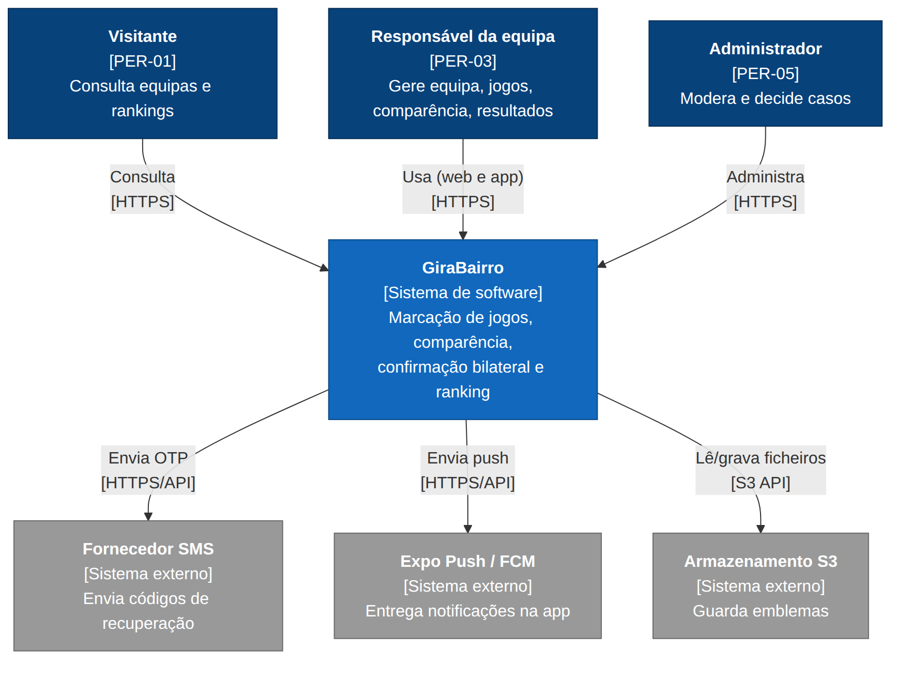
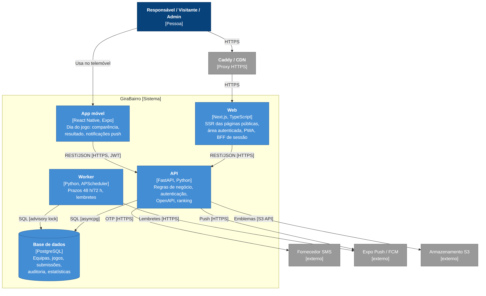
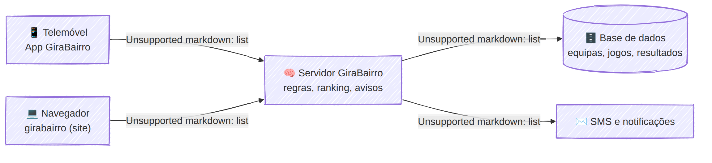

# Arquitetura — GiraBairro

| Campo | Valor |
|-------|-------|
| Task | M3-03 (#40) |
| Versão | 1.0 — 2026-11-08 |
| Notação | Modelo C4 (níveis 1 e 2) em Mermaid; versão simplificada para o cliente em estilo à mão |
| Base | [stack.md](stack.md), [ADRs](adr/README.md) |

## 1. Contexto (C4 nível 1)

## 2. Contentores (C4 nível 2)

| Contentor | Tecnologia | Responsabilidade | Comunica com |
|-----------|-----------|------------------|--------------|
| Web | Next.js | Páginas públicas (SSR), área do responsável e do admin, PWA, gestão da sessão em cookies | API (REST/JSON) |
| App móvel | React Native / Expo | Fluxos do PER-03, em especial o dia do jogo; push | API (REST/JSON + JWT) |
| API | FastAPI | Regras de negócio (RN-01 a RN-25), autenticação/autorização, OpenAPI, ranking | PostgreSQL, SMS, Push, S3 |
| Worker | Python + APScheduler | UC18/UC19: prazos de 48 h/72 h, lembretes | PostgreSQL, Push |
| Base de dados | PostgreSQL | Fonte de verdade; auditoria imutável; estatísticas | — |
| Caddy / CDN | Proxy | HTTPS (RNF-022), compressão, cache de estáticos | Web, API |

> Toda a lógica de negócio vive **só na API**. Web e app são clientes "finos" que consomem o mesmo contrato ([openapi.yaml](openapi.yaml)).

## 3. Versão simplificada (para o cliente)

## 4. Fluxos principais

| Fluxo | Caminho |
|-------|---------|
| Visitante abre o ranking | Navegador → Caddy → Web (SSR) → API `GET /ranking` → PostgreSQL |
| Responsável submete resultado na app | App → API `POST /jogos/{id}/resultados` → PostgreSQL (transacção + auditoria + estatística) → Push para a adversária |
| Prazo de 48 h expira | Worker → PostgreSQL (confirma falta, recalcula) → Push / notificação interna |
