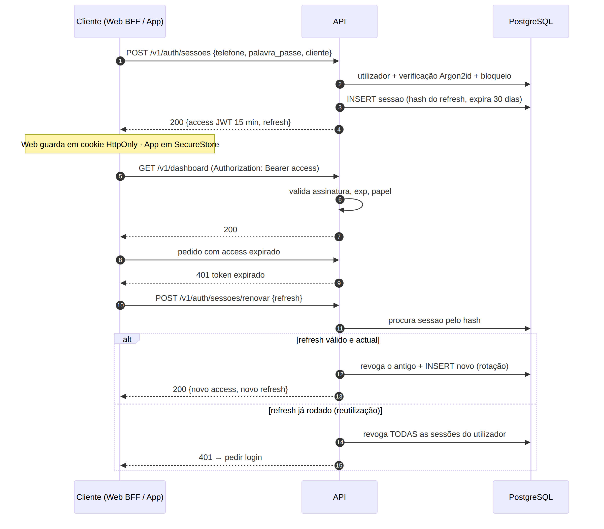

# Estratégia de Segurança — GiraBairro

| Campo | Valor |
|-------|-------|
| Task | M3-06 (#43) |
| Versão | 1.0 — 2026-11-08 |
| Base | RNF-020 a RNF-027, RNF-030/031; [ADR-006](adr/ADR-006-autenticacao-jwt.md); [contrato da API](openapi.yaml); decisões 3 e 9 |

## 1. Autenticação

| Tema | Regra |
|------|-------|
| Identificador | Telefone em formato E.164 (`+244…`), único (RF-01.03) |
| Palavra-passe | ≥ 8 caracteres; recusar as 10 000 mais comuns; **Argon2id** (memória 64 MiB, 3 iterações) — RNF-020/021 |
| Bloqueio | 5 falhas em 15 min → bloqueio de 15 min (`utilizador.bloqueado_ate`) — RNF-021; resposta 423 |
| Tokens | Access **JWT HS256/EdDSA de 15 min** com `sub`, `papel`, `equipa_id`, `exp`, `jti`; **refresh opaco de 30 dias**, rotativo, guardado em hash (`sessao`) — ADR-006 |
| Reutilização de refresh | Usar um refresh já rodado ⇒ revoga **todas** as sessões do utilizador (sinal de roubo) |
| Web | Tokens em cookies `HttpOnly; Secure; SameSite=Lax`, geridos pelas rotas do Next.js (BFF); protecção CSRF com `SameSite` + cabeçalho de origem |
| App | Tokens no `expo-secure-store` (Keystore Android) |
| Logout / nova palavra-passe / suspensão | Revoga as sessões (`sessao.revogada_em`) |
| Recuperação | OTP de 6 dígitos, hash na BD, 10 min, 3 tentativas, máx. 3 pedidos/h por telefone; resposta igual exista ou não a conta — RNF-025 |

## 2. Autorização (RBAC + propriedade)

Duas camadas, ambas **no servidor** (RNF-023):

1. **Papel** do utilizador: `utilizador` ou `admin` (PER-05).
2. **Propriedade**: o responsável só actua sobre **a sua equipa** e **os jogos em que a sua equipa participa** (RN-02, RN-13). O `equipa_id` do token é sempre **revalidado na BD** nas escritas (pode ter mudado desde a emissão).

Implementação: dependências FastAPI `utilizador_actual`, `exige_responsavel_da_equipa(equipa_id)`, `exige_participante_do_jogo(jogo_id)`, `exige_admin` (ver [padrão do backend](padrao-backend.md)).

### Matriz persona × permissão

| Recurso / acção | PER-01 Visitante | PER-02 Sem equipa | PER-03 Responsável | PER-05 Admin |
|-----------------|:---:|:---:|:---:|:---:|
| Pesquisar equipas, ver perfil, ranking, critérios | ✅ | ✅ | ✅ | ✅ |
| Ver **telefones** dos contactos (RN-17) | ❌ | ✅ | ✅ | ✅ |
| Ver **nomes** do plantel (RN-22) | só se `publico` | se `publico`/`autenticados` | idem; todos na sua equipa | ✅ |
| Criar conta / recuperar palavra-passe | ✅ | — | — | — |
| Ver/editar o seu perfil | ❌ | ✅ | ✅ | ✅ |
| Registar equipa (RN-18) | ❌ | ✅ | ❌ (já tem) | ❌ |
| Editar equipa, jogadores, contactos | ❌ | ❌ | ✅ só a sua | ❌ (só suspender) |
| Enviar solicitação (RN-19) | ❌ | ❌ | ✅ a equipas activas | ❌ |
| Responder/cancelar solicitação | ❌ | ❌ | ✅ se envolvida | ❌ |
| Comparência, resultado, contestar, pedir análise | ❌ | ❌ | ✅ só nos seus jogos, na janela (RN-23) | ❌ |
| Ver histórico/auditoria de um jogo | ❌ | ❌ | ✅ dos seus jogos | ✅ |
| Dashboard, notificações | ❌ | notificações | ✅ | ✅ |
| Suspender/reactivar, resolver casos, marcar realizado | ❌ | ❌ | ❌ | ✅ (com justificação) |
| Indicadores gerais | ❌ | ❌ | ❌ | ✅ |

> Um admin **não** pode submeter comparência/resultado em nome de uma equipa; só decide casos (UC17), deixando registo de auditoria.

## 3. Protecção de dados pessoais

| Dado | Classificação | Medidas |
|------|---------------|---------|
| Telefone do utilizador | Pessoal | Nunca exposto publicamente; só ao próprio e ao admin |
| Telefone dos contactos | Pessoal | Só a autenticados (RN-17); não incluído no HTML público (`noindex`) — RNF-024 |
| Nome dos jogadores | Pessoal | Visibilidade configurável (RN-22) |
| Palavra-passe, OTP, refresh token | Segredo | Só hash; nunca em logs |
| Auditoria | Registo legal | Imutável; acesso restrito |

- **Lei n.º 22/11 (Angola)**: termos e política de privacidade aceites no registo; pedido de exportação/eliminação de conta tratado pelo admin (RNF-026). Ao eliminar uma conta, os registos de jogos mantêm-se com o autor anonimizado (integridade do histórico — RN-12).
- **Minimização**: não se recolhe e-mail, data de nascimento nem localização GPS no MVP.
- **Logs**: telefones mascarados (`+2449****000`); sem corpos de pedidos de autenticação.

## 4. Protecção da aplicação

| Ameaça (OWASP) | Medida |
|----------------|--------|
| Injecção SQL | Só SQLAlchemy com parâmetros; sem SQL concatenado |
| XSS | React escapa por defeito; `dangerouslySetInnerHTML` proibido (lint); CSP restritiva no Next.js |
| CSRF | Cookies `SameSite=Lax` + verificação de `Origin` nas rotas BFF |
| Controlo de acesso | Matriz da secção 2 testada por endpoint (testes de 403) |
| Força bruta / abuso | Rate limiting (RNF-027): login 10/min por IP+telefone; OTP 3/h; solicitações 20/dia por equipa; geral 120/min por IP |
| Upload malicioso | Só JPG/PNG/WebP ≤ 2 MB; validação do conteúdo real com Pillow; reencode e remoção de metadados EXIF; nome de ficheiro aleatório |
| Enumeração de contas | Mesmas respostas/tempos em login e recuperação |
| Dependências vulneráveis | Dependabot + `pip-audit` / `pnpm audit` no CI |
| Segredos | Variáveis de ambiente / secrets do GitHub; nunca no repositório; `.env` no `.gitignore` |
| Transporte | HTTPS obrigatório, HSTS, TLS ≥ 1.2 (RNF-022) |
| Cabeçalhos | `X-Content-Type-Options`, `Referrer-Policy`, `Permissions-Policy`, CSP |

## 5. Auditoria e integridade (RN-12, RNF-030/031)

- Toda a escrita em `jogo`, `comparencia`, `submissao_resultado`, `solicitacao_jogo`, `caso_analise` e acções de admin grava `registo_auditoria` **na mesma transacção**.
- O utilizador da BD da aplicação tem só `INSERT`/`SELECT` em `registo_auditoria` (sem `UPDATE`/`DELETE`).
- Decisões de admin exigem `motivo` (restrição `CHECK`).
- Tarefas automáticas auditam com `utilizador_id = NULL` (autor "sistema").

## 6. Fluxo de autenticação

*Fonte: [`src/auth-flow.mmd`](src/auth-flow.mmd)*

## 7. Verificação (M9-03)

- Testes automáticos de autorização para cada operação da API (matriz da secção 2).
- Testes de bloqueio, expiração de OTP e rotação/reutilização de refresh token.
- Análise OWASP ZAP (baseline) contra staging antes da homologação.
