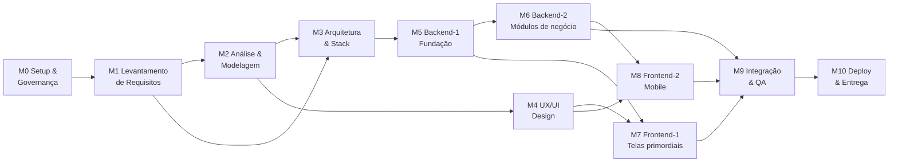
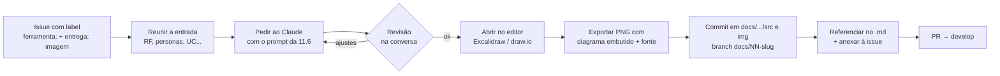

# Roteiro de Engenharia de Sistemas — Milestones, Tasks e Labels

---
Utilização especialmente para o GitHub
---


> Guia padrão para a equipa seguir na criação de qualquer sistema, desde a configuração do repositório até à entrega.
> Cada **Milestone** é uma fase com um objectivo claro e um **critério de saída** (Gate). Uma fase só fecha quando o gate está cumprido.

---

## Índice

1. [Visão geral do fluxo](#1-visão-geral-do-fluxo)
2. [Ajustes à lista original](#2-ajustes-à-lista-original)
3. [Convenções da equipa](#3-convenções-da-equipa)
4. [Labels](#4-labels)
5. [Milestones e tasks (sequência completa)](#5-milestones-e-tasks-sequência-completa)
6. [Estrutura de pastas da documentação](#6-estrutura-de-pastas-da-documentação)
7. [Quadro (GitHub Projects)](#7-quadro-github-projects)
8. [Templates de Issue e Pull Request](#8-templates-de-issue-e-pull-request)
9. [Script de configuração (labels + milestones)](#9-script-de-configuração-labels--milestones)
10. [Definition of Ready / Definition of Done](#10-definition-of-ready--definition-of-done)
11. [Diagramas com Excalidraw e draw.io (MCP)](#11-diagramas-com-excalidraw-e-drawio-mcp)

---

## 1. Visão geral do fluxo



| # | Milestone | Objectivo | Entregável principal |
|---|-----------|-----------|----------------------|
| M0 | **Setup & Governança** | Preparar o terreno de trabalho | Repositório, branches, labels, milestones, quadro |
| M1 | **Levantamento de Requisitos** | Perceber *o quê* e *para quem* | Documento de requisitos priorizado (MoSCoW) |
| M2 | **Análise & Modelagem** | Modelar o domínio e o comportamento | Casos de uso, MER, dicionário de dados, classes, sequência |
| M3 | **Arquitetura & Stack** | Decidir *como* construir | Stack, arquitetura, contrato da API (ADRs) |
| M4 | **UX/UI Design** | Desenhar a experiência | Wireframes, protótipo, design system |
| M5 | **Backend-1: Fundação** | Base técnica do servidor | Projecto, BD, autenticação, CI |
| M6 | **Backend-2: Módulos de negócio** | Regras de negócio | Endpoints dos requisitos *Must* e *Should* |
| M7 | **Frontend-1: Telas primordiais** | Interface web principal | Telas web ligadas à API |
| M8 | **Frontend-2: Mobile** | Interface mobile | App mobile funcional |
| M9 | **Integração & QA** | Garantir qualidade | Testes E2E, correcções, homologação |
| M10 | **Deploy & Entrega** | Pôr em produção | Sistema em produção + documentação final |

> **Nota:** M7 e M8 podem correr em paralelo com M6 desde que a API esteja contratada (M3-05) e haja mocks.

---

## 2. Ajustes à lista original

| Item original | Ajuste | Motivo |
|---------------|--------|--------|
| "Definir stack e tecnologias" **e** "Definição da stack" | Unificados numa única task (**M3-01**) | Eram a mesma tarefa duplicada |
| "Definir Personas" vinha depois dos requisitos | Movido para **antes** dos requisitos (M1-03) | Os RNF *de cada persona* dependem das personas existirem |
| "Definir stack" vinha no início | Movido para **M3**, depois dos RNF | A stack deve responder aos RNF (desempenho, offline, escala…), não o contrário |
| "Requisitos no funionais" | → "Requisitos **não** funcionais" | Correcção |
| Faltavam etapas | Acrescentadas: visão do projecto, stakeholders, user stories, critérios de aceitação, ADRs, contrato da API, wireframes, testes, CI/CD, deploy | Fazem parte do processo completo de engenharia de sistemas |

---

## 3. Convenções da equipa

### 3.1 Branches (Git Flow simplificado)

| Branch | Origem | Destino | Uso |
|--------|--------|---------|-----|
| `main` | — | — | Código em produção. **Protegida**, só recebe merge de `release/*` e `hotfix/*` |
| `develop` | `main` | — | Integração contínua do trabalho. **Protegida**, só via PR |
| `feature/<nº-issue>-<slug>` | `develop` | `develop` | Nova funcionalidade. Ex.: `feature/42-login-jwt` |
| `docs/<nº-issue>-<slug>` | `develop` | `develop` | Documentação. Ex.: `docs/12-diagrama-classes` |
| `fix/<nº-issue>-<slug>` | `develop` | `develop` | Correcção não urgente |
| `release/vX.Y.Z` | `develop` | `main` + `develop` | Preparação de versão |
| `hotfix/<slug>` | `main` | `main` + `develop` | Correcção urgente em produção |

**Regras de protecção (`main` e `develop`):**
- Pull Request obrigatório
- Mínimo **1 aprovação**
- CI a passar (quando existir, a partir de M5)
- Proibido push directo e force push

### 3.2 Commits (Conventional Commits)

```
<tipo>(<escopo>): <descrição curta>

feat(auth): adiciona login com JWT
fix(stock): corrige cálculo de saldo negativo
docs(mer): adiciona entidade Pedido
chore(repo): configura labels
```

Tipos: `feat`, `fix`, `docs`, `chore`, `refactor`, `test`, `style`, `ci`.

### 3.3 Nomenclatura das tasks

Título da issue: **`[Mx-NN] Verbo + objecto`**

- `[M1-04] Levantar requisitos funcionais`
- `[M2-03] Elaborar Modelo Entidade-Relacionamento`

O código `Mx-NN` torna a ordem visível em qualquer lista e permite referenciar dependências (`Depende de: #M1-04`).

### 3.4 Personas

Codificar como **PER-01, PER-02…** e usar o código em todos os artefactos (RF, RNF, casos de uso, user stories).

Exemplo:
| Código | Persona | Descrição |
|--------|---------|-----------|
| PER-01 | Administrador | Gere utilizadores, configurações e relatórios |
| PER-02 | Operador | Executa as operações diárias do sistema |
| PER-03 | Cliente | Utilizador final, acede via mobile |

### 3.5 Requisitos

| Tipo | Código | Exemplo |
|------|--------|---------|
| Funcional | `RF-001` | RF-001 — O sistema deve permitir que PER-02 registe uma venda |
| Não funcional | `RNF-001` | RNF-001 — [PER-03] A app deve abrir em menos de 2 s em rede 3G |
| Regra de negócio | `RN-001` | RN-001 — Um pedido só pode ser cancelado até 24 h após criação |
| User story | `US-001` | Como PER-02, quero… para… |

---

## 4. Labels

Organizadas por **prefixo** para facilitar filtros. Cada issue deve ter **pelo menos**: 1 `tipo`, 1 `area`, 1 `prioridade`.

### 4.1 Tipo — *o que é*
| Label | Cor | Descrição |
|-------|-----|-----------|
| `tipo: feature` | `#1D76DB` | Nova funcionalidade |
| `tipo: docs` | `#0075CA` | Documentação / artefacto de engenharia |
| `tipo: bug` | `#D73A4A` | Erro a corrigir |
| `tipo: chore` | `#C5DEF5` | Configuração, manutenção, tarefas de suporte |
| `tipo: refactor` | `#BFD4F2` | Melhoria de código sem mudar comportamento |
| `tipo: test` | `#5319E7` | Criação ou melhoria de testes |
| `tipo: spike` | `#F9D0C4` | Investigação / prova de conceito com tempo limitado |

### 4.2 Área — *onde*
| Label | Cor | Descrição |
|-------|-----|-----------|
| `area: gestão` | `#EDEDED` | Repositório, quadro, processos |
| `area: requisitos` | `#FEF2C0` | Levantamento e especificação |
| `area: modelagem` | `#FBCA04` | Diagramas UML, MER, dicionário de dados |
| `area: arquitetura` | `#E99695` | Stack, ADRs, desenho técnico |
| `area: ux-ui` | `#F9A8D4` | Wireframes, protótipos, design system |
| `area: backend` | `#0E8A16` | Servidor / API |
| `area: database` | `#006B75` | Base de dados, migrações |
| `area: frontend` | `#7057FF` | Web |
| `area: mobile` | `#8B5CF6` | Aplicação mobile |
| `area: devops` | `#000000` | CI/CD, infra, deploy |
| `area: qa` | `#B60205` | Qualidade e testes |

### 4.3 Prioridade — *MoSCoW*
| Label | Cor | Significado |
|-------|-----|-------------|
| `prioridade: must` | `#B60205` | Obrigatório para a entrega |
| `prioridade: should` | `#D93F0B` | Importante, mas a entrega sobrevive sem ele |
| `prioridade: could` | `#FBCA04` | Desejável, se houver tempo |
| `prioridade: wont` | `#CCCCCC` | Fora do âmbito desta versão |

### 4.4 Estado — *situação especial*
| Label | Cor | Uso |
|-------|-----|-----|
| `estado: bloqueado` | `#000000` | Depende de algo não resolvido (indicar no comentário) |
| `estado: precisa-info` | `#D876E3` | Falta informação do cliente/equipa |
| `estado: em-revisão` | `#0052CC` | Aguarda revisão de PR |

> O fluxo normal (*A fazer → Em curso → Revisão → Feito*) fica nas **colunas do quadro**, não em labels.

### 4.5 Tamanho — *esforço*
| Label | Cor | Referência |
|-------|-----|------------|
| `tamanho: XS` | `#C2E0C6` | < 2 h |
| `tamanho: S` | `#A2EEEF` | ½ dia |
| `tamanho: M` | `#7DD3FC` | 1–2 dias |
| `tamanho: L` | `#3B82F6` | 3–5 dias |
| `tamanho: XL` | `#1E3A8A` | > 1 semana → **dividir a task** |

### 4.6 Ferramenta — *com o que se desenha*
| Label | Cor | Uso |
|-------|-----|-----|
| `ferramenta: excalidraw` | `#6965DB` | Diagrama informal / explicação de fluxo (Excalidraw MCP) |
| `ferramenta: drawio` | `#F08705` | Diagrama formal UML / MER / arquitetura (draw.io MCP) |
| `entrega: imagem` | `#0E8A16` | A task exige exportar PNG/SVG para `docs/` |

> Ver a matriz completa na [secção 11](#11-diagramas-com-excalidraw-e-drawio-mcp).

### 4.7 Persona (opcional)
`persona: PER-01`, `persona: PER-02`… cor `#FFFFFF`. Útil para filtrar tudo o que afecta uma persona.

---

## 5. Milestones e tasks (sequência completa)

Legenda das colunas: **Dep.** = tasks que têm de estar concluídas antes.

---

### 🏁 M0 — Setup & Governança

**Objectivo:** deixar a equipa pronta para trabalhar de forma organizada.

| Código | Task | Labels | Dep. | Entregável |
|--------|------|--------|------|------------|
| M0-01 | Criar repositório no GitHub (README, `.gitignore`, licença) | `tipo: chore` `area: gestão` `prioridade: must` | — | Repositório criado |
| M0-02 | Definir branches `main` e `develop` + regras de protecção | `tipo: chore` `area: gestão` `prioridade: must` | M0-01 | Branches protegidas |
| M0-03 | Configurar labels | `tipo: chore` `area: gestão` `prioridade: must` | M0-01 | Labels da secção 4 |
| M0-04 | Configurar milestones das fases | `tipo: chore` `area: gestão` `prioridade: must` | M0-01 | Milestones M0–M10 |
| M0-05 | Criar quadro no GitHub Projects (colunas + vistas) | `tipo: chore` `area: gestão` `prioridade: must` | M0-03, M0-04 | Quadro activo |
| M0-06 | Criar templates de issue e PR | `tipo: chore` `area: gestão` `prioridade: should` | M0-01 | `.github/ISSUE_TEMPLATE/`, `pull_request_template.md` |
| M0-07 | Criar estrutura de pastas `docs/` | `tipo: docs` `area: gestão` `prioridade: should` | M0-01 | Estrutura da secção 6 |
| M0-08 | Documentar convenções (`CONTRIBUTING.md`) | `tipo: docs` `area: gestão` `prioridade: should` | M0-02 | Branches, commits, nomenclatura |
| M0-09 | Definir papéis da equipa e rituais (daily, revisão semanal) | `tipo: docs` `area: gestão` `prioridade: could` | — | Tabela de responsáveis |
| M0-10 | **Ligar os conectores MCP do Excalidraw e do draw.io** (claude.ai + Claude Code) | `tipo: chore` `area: gestão` `prioridade: must` | — | Ambos respondem a um diagrama de teste (ver 11.2) |
| M0-11 | Instalar draw.io Desktop (exportação PNG/SVG por CLI) | `tipo: chore` `area: gestão` `prioridade: should` | M0-10 | `drawio --version` funciona |

**🚪 Gate M0:** qualquer membro consegue clonar, criar uma branch `feature/*`, abrir PR para `develop` e ver a issue a mover-se no quadro.

---

### 📋 M1 — Levantamento de Requisitos

**Objectivo:** documentar o problema, os utilizadores e o que o sistema tem de fazer.

| Código | Task | Labels | Dep. | Entregável |
|--------|------|--------|------|------------|
| M1-01 | Documento de visão (problema, objectivos, âmbito, fora de âmbito) | `tipo: docs` `area: requisitos` `prioridade: must` | M0-07 | `docs/01-requisitos/visao.md` |
| M1-01a | 🖼️ Diagrama de contexto do sistema (sistema ↔ actores ↔ sistemas externos) | `tipo: docs` `area: requisitos` `ferramenta: excalidraw` `entrega: imagem` `prioridade: must` | M1-01 | `img/contexto.png` |
| M1-02 | Identificar stakeholders | `tipo: docs` `area: requisitos` `prioridade: must` | M1-01 | Tabela de stakeholders |
| M1-02a | 🖼️ Mapa de stakeholders (influência × interesse) | `tipo: docs` `area: requisitos` `ferramenta: excalidraw` `entrega: imagem` `prioridade: should` | M1-02 | `img/stakeholders.png` |
| M1-02b | 🖼️ Processo actual (AS-IS) e futuro (TO-BE) em BPMN | `tipo: docs` `area: requisitos` `ferramenta: drawio` `entrega: imagem` `prioridade: must` | M1-02 | `img/processo-as-is.png`, `img/processo-to-be.png` |
| M1-03 | **Definir personas (PER-01, PER-02…)** | `tipo: docs` `area: requisitos` `prioridade: must` | M1-02 | `personas.md` |
| M1-03a | 🖼️ Jornada do utilizador por persona | `tipo: docs` `area: requisitos` `ferramenta: excalidraw` `entrega: imagem` `prioridade: should` | M1-03 | `img/jornada-PER-0X.png` |
| M1-04 | Levantar requisitos funcionais (RF) | `tipo: docs` `area: requisitos` `prioridade: must` | M1-03 | `requisitos-funcionais.md` |
| M1-05 | Levantar requisitos não funcionais **de cada persona** (RNF) | `tipo: docs` `area: requisitos` `prioridade: must` | M1-03 | `requisitos-nao-funcionais.md` |
| M1-06 | Levantar regras de negócio (RN) | `tipo: docs` `area: requisitos` `prioridade: must` | M1-04 | `regras-negocio.md` |
| M1-07 | **Priorizar requisitos (MoSCoW)** | `tipo: docs` `area: requisitos` `prioridade: must` | M1-04, M1-05 | Coluna de prioridade nos RF/RNF |
| M1-07a | 🖼️ Quadro MoSCoW visual (4 colunas com os códigos RF/RNF) para apresentação | `tipo: docs` `area: requisitos` `ferramenta: excalidraw` `entrega: imagem` `prioridade: could` | M1-07 | `img/moscow.png` |
| M1-08 | Escrever user stories com critérios de aceitação | `tipo: docs` `area: requisitos` `prioridade: should` | M1-07 | `user-stories.md` |
| M1-09 | Matriz de rastreabilidade (RF ↔ Persona ↔ US) | `tipo: docs` `area: requisitos` `prioridade: could` | M1-08 | `rastreabilidade.md` |
| M1-10 | Validar requisitos com o cliente/orientador | `tipo: docs` `area: requisitos` `prioridade: must` | M1-07 | Acta / aprovação |

**🚪 Gate M1:** requisitos aprovados; cada RF e RNF tem código, persona associada e prioridade MoSCoW; diagramas de contexto e de processo (TO-BE) exportados como imagem e referenciados no documento.

---

### 🧩 M2 — Análise & Modelagem

**Objectivo:** transformar requisitos em modelos que orientam a implementação.

| Código | Task | Labels | Dep. | Entregável |
|--------|------|--------|------|------------|
| M2-01 | **Diagrama de casos de uso** (actores = personas) | `tipo: docs` `area: modelagem` `prioridade: must` | M1-10 | `casos-de-uso.png` + fonte |
| M2-02 | Especificação dos casos de uso principais (fluxo principal/alternativo) | `tipo: docs` `area: modelagem` `prioridade: should` | M2-01 | `especificacao-casos-uso.md` |
| M2-03 | **Modelo Entidade-Relacionamento (MER)** — conceptual | `tipo: docs` `area: modelagem` `area: database` `prioridade: must` | M1-10 | `mer-conceptual` |
| M2-04 | Modelo lógico/físico (tabelas, FKs, cardinalidades) | `tipo: docs` `area: database` `prioridade: must` | M2-03 | `mer-logico` |
| M2-05 | **Dicionário de dados** (atributos, tipos, chaves, restrições) | `tipo: docs` `area: database` `prioridade: must` | M2-04 | `dicionario-dados.md` |
| M2-06 | **Diagrama de classes** | `tipo: docs` `area: modelagem` `prioridade: must` | M2-03, M2-01 | `diagrama-classes` |
| M2-07 | **Diagramas de sequência** (1 por caso de uso crítico) | `tipo: docs` `area: modelagem` `prioridade: must` | M2-02, M2-06 | `sequencia-*.png` |
| M2-08 | Diagrama de actividades / estados (processos com fluxo complexo) | `tipo: docs` `area: modelagem` `prioridade: could` | M2-02 | Diagramas extra |
| M2-09 | Revisão cruzada da modelagem (consistência MER ↔ classes ↔ dicionário) | `tipo: docs` `area: modelagem` `prioridade: must` | M2-05, M2-06, M2-07 | Checklist de revisão |

**Ordem lógica dentro da fase:**
```
Casos de uso ─┬─► Especificação ─► Sequência
              │                      ▲
MER ─► Lógico ─► Dicionário          │
  └──────────────► Classes ──────────┘
```

> 🖼️ **Todas as tasks de diagrama desta fase usam `ferramenta: drawio` + `entrega: imagem`** (notação UML/ER formal). Os diagramas de sequência são gerados a partir de **Mermaid** no draw.io, para o texto-fonte também ficar versionado. Ver [11.3](#113-matriz-task--ferramenta).

**🚪 Gate M2:** cada caso de uso *Must* tem diagrama de sequência; MER, classes e dicionário de dados são consistentes entre si; todos os diagramas têm fonte editável + PNG em `docs/`.

---

### 🏗️ M3 — Arquitetura & Stack

**Objectivo:** decidir as tecnologias e a estrutura técnica, justificando com os RNF.

| Código | Task | Labels | Dep. | Entregável |
|--------|------|--------|------|------------|
| M3-01 | **Definir stack e tecnologias** (front, mobile, back, BD, infra) | `tipo: docs` `area: arquitetura` `prioridade: must` | M1-07 | `stack.md` com justificação por RNF |
| M3-02 | Registar decisões em ADRs (Architecture Decision Records) | `tipo: docs` `area: arquitetura` `prioridade: should` | M3-01 | `docs/03-arquitetura/adr/ADR-001-*.md` |
| M3-03 | Diagrama de arquitetura (C4: contexto e contentores) | `tipo: docs` `area: arquitetura` `prioridade: must` | M3-01 | `arquitetura.png` |
| M3-04 | Definir padrão arquitectural do backend (camadas, Clean Architecture…) | `tipo: docs` `area: arquitetura` `prioridade: must` | M3-01, M2-06 | Estrutura de pastas do código |
| M3-05 | **Contrato da API** (OpenAPI/Swagger) | `tipo: docs` `area: arquitetura` `area: backend` `prioridade: must` | M2-07, M3-01 | `openapi.yaml` |
| M3-06 | Estratégia de segurança (autenticação, autorização por persona, dados sensíveis) | `tipo: docs` `area: arquitetura` `prioridade: must` | M3-01, M1-05 | `seguranca.md` |
| M3-07 | Definir ambientes (dev, staging, prod) e variáveis | `tipo: docs` `area: devops` `prioridade: should` | M3-01 | `ambientes.md` |
| M3-08 | Spike / prova de conceito de tecnologia de risco | `tipo: spike` `area: arquitetura` `prioridade: could` | M3-01 | Relatório curto |

**🚪 Gate M3:** stack aprovada, contrato da API publicado; front e back conseguem trabalhar em paralelo a partir do contrato.

---

### 🎨 M4 — UX/UI Design

**Objectivo:** desenhar as telas antes de as programar.

| Código | Task | Labels | Dep. | Entregável |
|--------|------|--------|------|------------|
| M4-01 | Mapa de navegação / fluxo de telas por persona | `tipo: docs` `area: ux-ui` `prioridade: must` | M2-01 | Fluxograma |
| M4-02 | Wireframes (baixa fidelidade) — web | `tipo: docs` `area: ux-ui` `prioridade: must` | M4-01 | Wireframes |
| M4-03 | Wireframes (baixa fidelidade) — mobile | `tipo: docs` `area: ux-ui` `prioridade: must` | M4-01 | Wireframes |
| M4-04 | Design system (cores, tipografia, componentes) | `tipo: docs` `area: ux-ui` `prioridade: should` | M4-02 | Guia de estilos |
| M4-05 | Protótipo de alta fidelidade (Figma) | `tipo: docs` `area: ux-ui` `prioridade: should` | M4-04 | Link do protótipo |
| M4-06 | Validar protótipo com utilizadores/cliente | `tipo: docs` `area: ux-ui` `prioridade: should` | M4-05 | Feedback registado |

**🚪 Gate M4:** telas *Must* desenhadas e aprovadas.

---

### ⚙️ M5 — Backend-1: Fundação

**Objectivo:** criar a base técnica sobre a qual os módulos vão assentar.

| Código | Task | Labels | Dep. | Entregável |
|--------|------|--------|------|------------|
| M5-01 | Inicializar projecto backend com a estrutura definida | `tipo: chore` `area: backend` `prioridade: must` | M3-04 | Projecto a correr localmente |
| M5-02 | Docker / docker-compose (app + BD) | `tipo: chore` `area: devops` `prioridade: should` | M5-01 | `docker-compose.yml` |
| M5-03 | Criar migrações da BD a partir do dicionário de dados | `tipo: feature` `area: database` `prioridade: must` | M2-05, M5-01 | Migrações |
| M5-04 | Seeds (dados iniciais e de teste) | `tipo: chore` `area: database` `prioridade: should` | M5-03 | Scripts de seed |
| M5-05 | Autenticação (registo, login, tokens) | `tipo: feature` `area: backend` `prioridade: must` | M3-06, M5-03 | Endpoints auth |
| M5-06 | Autorização por perfil/persona (RBAC) | `tipo: feature` `area: backend` `prioridade: must` | M5-05 | Middleware de permissões |
| M5-07 | Tratamento de erros, logs e validação padrão | `tipo: feature` `area: backend` `prioridade: must` | M5-01 | Middleware global |
| M5-08 | Pipeline CI (lint + testes em cada PR) | `tipo: chore` `area: devops` `prioridade: must` | M5-01 | GitHub Actions |
| M5-09 | Documentação Swagger servida pela API | `tipo: docs` `area: backend` `prioridade: should` | M3-05, M5-01 | `/docs` acessível |

**🚪 Gate M5:** login funcional com permissões por persona, BD criada por migrações, CI a validar PRs.

---

### 🧠 M6 — Backend-2: Módulos de negócio

**Objectivo:** implementar os requisitos funcionais, por ordem de prioridade.

> Criar **1 issue por módulo/RF** (ou por user story). Ordem: todos os `must` → depois `should` → depois `could`.

| Código | Task (modelo) | Labels | Dep. | Entregável |
|--------|---------------|--------|------|------------|
| M6-01 | Módulo `<A>` — CRUD + regras (RF-00X, RN-00X) | `tipo: feature` `area: backend` `prioridade: must` | M5-06 | Endpoints + testes |
| M6-02 | Módulo `<B>` — … | `tipo: feature` `area: backend` `prioridade: must` | M5-06 | Endpoints + testes |
| M6-03 | Módulo `<C>` — … | `tipo: feature` `area: backend` `prioridade: should` | M6-01 | Endpoints + testes |
| M6-0N | Relatórios / dashboards | `tipo: feature` `area: backend` `prioridade: should` | módulos base | Endpoints |
| M6-XX | Integrações externas (pagamentos, e-mail, SMS, ERP…) | `tipo: feature` `area: backend` `prioridade: conforme MoSCoW` | M6-01 | Integração + testes |
| M6-YY | Testes unitários e de integração (cobertura mínima definida) | `tipo: test` `area: backend` `prioridade: must` | contínuo | Relatório de cobertura |

> Se o backend for grande, dividir em **Backend-2**, **Backend-3**… por grupo de módulos.

**🚪 Gate M6:** todos os RF *Must* implementados, testados e conformes ao contrato da API.

---

### 🖥️ M7 — Frontend-1: Telas primordiais (Web)

**Objectivo:** construir a interface web principal.

| Código | Task | Labels | Dep. | Entregável |
|--------|------|--------|------|------------|
| M7-01 | Inicializar projecto web + estrutura de pastas | `tipo: chore` `area: frontend` `prioridade: must` | M3-01 | Projecto a correr |
| M7-02 | Implementar design system (componentes base) | `tipo: feature` `area: frontend` `prioridade: must` | M4-04, M7-01 | Botões, inputs, tabelas, layout |
| M7-03 | Camada de comunicação com a API (cliente HTTP, interceptors) | `tipo: feature` `area: frontend` `prioridade: must` | M3-05, M7-01 | Serviço de API |
| M7-04 | Tela de login + gestão de sessão | `tipo: feature` `area: frontend` `prioridade: must` | M5-05, M7-03 | Login funcional |
| M7-05 | Layout principal (menu por persona, rotas protegidas) | `tipo: feature` `area: frontend` `prioridade: must` | M7-04 | Navegação |
| M7-06 | Telas dos módulos *Must* (1 issue por tela) | `tipo: feature` `area: frontend` `prioridade: must` | M7-05, M6-xx | Telas ligadas à API |
| M7-07 | Telas *Should* / *Could* | `tipo: feature` `area: frontend` `prioridade: should` | M7-06 | Telas |
| M7-08 | Responsividade e acessibilidade básica | `tipo: feature` `area: frontend` `prioridade: should` | M7-06 | Checklist |

> Se necessário: **Frontend-1** = telas primordiais, **Frontend-3** = painel administrativo / relatórios.

**🚪 Gate M7:** fluxos *Must* executáveis de ponta a ponta na web.

---

### 📱 M8 — Frontend-2: Mobile

**Objectivo:** construir a aplicação mobile.

| Código | Task | Labels | Dep. | Entregável |
|--------|------|--------|------|------------|
| M8-01 | Inicializar projecto mobile | `tipo: chore` `area: mobile` `prioridade: must` | M3-01 | App a correr no emulador/dispositivo |
| M8-02 | Componentes base / tema mobile | `tipo: feature` `area: mobile` `prioridade: must` | M4-04, M8-01 | Componentes |
| M8-03 | Cliente da API + armazenamento seguro do token | `tipo: feature` `area: mobile` `prioridade: must` | M3-05, M8-01 | Serviço de API |
| M8-04 | Login e navegação | `tipo: feature` `area: mobile` `prioridade: must` | M8-03 | Fluxo de entrada |
| M8-05 | Telas *Must* da persona mobile (1 issue por tela) | `tipo: feature` `area: mobile` `prioridade: must` | M8-04, M6-xx | Telas |
| M8-06 | Funcionalidades nativas (câmara, notificações, offline…) conforme RNF | `tipo: feature` `area: mobile` `prioridade: should` | M8-05 | Funcionalidades |
| M8-07 | Build de teste (APK / TestFlight) | `tipo: chore` `area: mobile` `prioridade: must` | M8-05 | Build distribuída |

**🚪 Gate M8:** app instalável com fluxos *Must* funcionais.

---

### ✅ M9 — Integração & QA

**Objectivo:** garantir que tudo funciona junto e cumpre os requisitos.

| Código | Task | Labels | Dep. | Entregável |
|--------|------|--------|------|------------|
| M9-01 | Plano de testes (casos de teste a partir dos critérios de aceitação) | `tipo: test` `area: qa` `prioridade: must` | M1-08 | `plano-testes.md` |
| M9-02 | Testes E2E dos fluxos críticos | `tipo: test` `area: qa` `prioridade: must` | M7, M8 | Testes automatizados |
| M9-03 | Testes de RNF (desempenho, segurança, usabilidade) | `tipo: test` `area: qa` `prioridade: should` | M9-01 | Relatório |
| M9-04 | Correcção de bugs encontrados | `tipo: bug` `area: *` `prioridade: conforme gravidade` | M9-02 | Issues fechadas |
| M9-05 | Homologação / UAT com o cliente | `tipo: test` `area: qa` `prioridade: must` | M9-04 | Aceite formal |
| M9-06 | Verificar matriz de rastreabilidade (todos os RF *Must* cobertos) | `tipo: docs` `area: qa` `prioridade: must` | M9-05 | Matriz actualizada |

**🚪 Gate M9:** zero bugs críticos em aberto; cliente aceita a versão.

---

### 🚀 M10 — Deploy & Entrega

**Objectivo:** colocar o sistema em produção e entregar a documentação.

| Código | Task | Labels | Dep. | Entregável |
|--------|------|--------|------|------------|
| M10-01 | Pipeline CD (deploy automático para staging) | `tipo: chore` `area: devops` `prioridade: must` | M5-08 | Workflow de deploy |
| M10-02 | Configurar ambiente de produção (servidor, domínio, HTTPS, BD) | `tipo: chore` `area: devops` `prioridade: must` | M3-07 | Produção pronta |
| M10-03 | Backups e monitorização | `tipo: chore` `area: devops` `prioridade: should` | M10-02 | Rotina de backup + alertas |
| M10-04 | Criar `release/v1.0.0`, merge em `main`, tag | `tipo: chore` `area: gestão` `prioridade: must` | M9-05 | Release no GitHub |
| M10-05 | Publicar app mobile (lojas ou distribuição interna) | `tipo: chore` `area: mobile` `prioridade: should` | M8-07, M9-05 | App publicada |
| M10-06 | Manual do utilizador (por persona) | `tipo: docs` `area: gestão` `prioridade: should` | M9-05 | `manual-utilizador.md` |
| M10-07 | Manual técnico / guia de instalação | `tipo: docs` `area: devops` `prioridade: must` | M10-02 | `manual-tecnico.md` |
| M10-08 | Retrospectiva do projecto | `tipo: docs` `area: gestão` `prioridade: could` | M10-04 | Lições aprendidas |

**🚪 Gate M10:** sistema em produção, versão marcada, documentação entregue.

---

## 6. Estrutura de pastas da documentação

```
docs/
├── 00-gestao/
│   ├── equipa-e-papeis.md
│   └── actas/
├── 01-requisitos/
│   ├── img/                    ← PNG/SVG exportados (Excalidraw + draw.io)
│   ├── src/                    ← fontes .excalidraw / .drawio
│   ├── visao.md
│   ├── stakeholders.md
│   ├── personas.md
│   ├── requisitos-funcionais.md
│   ├── requisitos-nao-funcionais.md
│   ├── regras-negocio.md
│   ├── user-stories.md
│   └── rastreabilidade.md
├── 02-modelagem/
│   ├── img/
│   ├── src/                    ← .drawio e .mmd (Mermaid)
│   ├── casos-de-uso/
│   ├── mer/
│   ├── dicionario-dados.md
│   ├── diagrama-classes/
│   └── sequencia/
├── 03-arquitetura/
│   ├── stack.md
│   ├── arquitetura.md
│   ├── seguranca.md
│   ├── ambientes.md
│   ├── openapi.yaml
│   └── adr/
├── 04-ux-ui/
│   ├── fluxo-telas.md
│   └── wireframes/
├── 05-qa/
│   └── plano-testes.md
└── 06-entrega/
    ├── manual-utilizador.md
    └── manual-tecnico.md
```

> Guardar sempre a **fonte** dos diagramas (`.drawio`, `.excalidraw`, `.mmd`) além da imagem exportada, para poderem ser editados. Regras de nomes e exportação na [secção 11.5](#115-exportar-para-imagem-e-versionar).

### Modelo de dicionário de dados

| Tabela | Atributo | Tipo | Tamanho | Nulo | Chave | Default | Descrição |
|--------|----------|------|---------|------|-------|---------|-----------|
| `utilizador` | `id` | UUID | — | Não | PK | `gen_random_uuid()` | Identificador |
| `utilizador` | `email` | VARCHAR | 150 | Não | UK | — | E-mail de acesso |
| `utilizador` | `perfil_id` | INT | — | Não | FK → `perfil.id` | — | Persona/perfil |
| `utilizador` | `criado_em` | TIMESTAMP | — | Não | — | `now()` | Data de criação |

### Modelo de requisitos com MoSCoW

| Código | Descrição | Persona | Prioridade | Origem |
|--------|-----------|---------|------------|--------|
| RF-001 | O sistema deve permitir… | PER-02 | Must | Entrevista 03/11 |
| RNF-001 | Tempo de resposta < 2 s | PER-03 | Should | RF-001 |

---

## 7. Quadro (GitHub Projects)

### Colunas
| Coluna | Significado |
|--------|-------------|
| 📥 **Backlog** | Criada, ainda não está pronta para começar |
| 📌 **Pronto** | Cumpre a *Definition of Ready* |
| 🔨 **Em curso** | Alguém está a trabalhar (tem responsável e branch) |
| 👀 **Em revisão** | PR aberto |
| ✅ **Feito** | Merge em `develop` + DoD cumprida |

### Vistas recomendadas
- **Por milestone** (board agrupado por milestone) — visão da fase actual
- **Roadmap** (timeline com datas das milestones) — visão do projecto inteiro
- **Por responsável** — carga de cada membro
- **Bloqueados** — filtro `label:"estado: bloqueado"`

### Campos personalizados úteis
`Início`, `Fim`, `Estimativa`, `Sprint` (se usarem sprints).

---

## 8. Templates de Issue e Pull Request

### `.github/ISSUE_TEMPLATE/task.md`

```markdown
---
name: Task
about: Tarefa do roteiro de engenharia
title: "[Mx-NN] "
labels: ""
---

## Objectivo
<!-- O que deve ser feito e porquê -->

## Referências
- Requisitos: RF-___ / RNF-___
- Persona: PER-__
- Documento: docs/...

## Critérios de aceitação
- [ ] ...
- [ ] ...

## Dependências
- Depende de: #
- Bloqueia: #

## Entregável
<!-- Ficheiro, endpoint, tela, diagrama... -->
```

### `.github/ISSUE_TEMPLATE/bug.md`

```markdown
---
name: Bug
about: Reportar um erro
title: "[BUG] "
labels: "tipo: bug"
---

## Descrição
## Passos para reproduzir
1.
2.
## Resultado esperado
## Resultado obtido
## Ambiente (web/mobile, versão, navegador)
## Evidências (prints, logs)
```

### `.github/pull_request_template.md`

```markdown
## O que foi feito
<!-- Resumo -->

Closes #

## Tipo
- [ ] feat  - [ ] fix  - [ ] docs  - [ ] refactor  - [ ] test  - [ ] chore

## Checklist
- [ ] Branch criada a partir de `develop`
- [ ] Segue as convenções do CONTRIBUTING.md
- [ ] Testes adicionados/actualizados
- [ ] Documentação actualizada (se aplicável)
- [ ] Sem conflitos com `develop`

## Como testar
```

---

## 9. Script de configuração (labels + milestones)

Requer [GitHub CLI](https://cli.github.com/) autenticado (`gh auth login`). Executar na raiz do repositório.

```bash
#!/usr/bin/env bash
# setup-github.sh — cria labels e milestones do roteiro
set -e

REPO=$(gh repo view --json nameWithOwner -q .nameWithOwner)
echo "Repositório: $REPO"

# --- Remover labels por defeito (opcional) ---
for l in "bug" "documentation" "duplicate" "enhancement" "good first issue" \
         "help wanted" "invalid" "question" "wontfix"; do
  gh label delete "$l" --yes 2>/dev/null || true
done

# --- Labels: "nome|cor|descrição" ---
LABELS=(
  "tipo: feature|1D76DB|Nova funcionalidade"
  "tipo: docs|0075CA|Documentação / artefacto de engenharia"
  "tipo: bug|D73A4A|Erro a corrigir"
  "tipo: chore|C5DEF5|Configuração e manutenção"
  "tipo: refactor|BFD4F2|Melhoria sem mudar comportamento"
  "tipo: test|5319E7|Testes"
  "tipo: spike|F9D0C4|Investigação com tempo limitado"

  "area: gestão|EDEDED|Repositório, quadro, processos"
  "area: requisitos|FEF2C0|Levantamento e especificação"
  "area: modelagem|FBCA04|UML, MER, dicionário de dados"
  "area: arquitetura|E99695|Stack, ADRs, desenho técnico"
  "area: ux-ui|F9A8D4|Wireframes, protótipos"
  "area: backend|0E8A16|Servidor / API"
  "area: database|006B75|Base de dados"
  "area: frontend|7057FF|Web"
  "area: mobile|8B5CF6|App mobile"
  "area: devops|000000|CI/CD, infra, deploy"
  "area: qa|B60205|Qualidade e testes"

  "prioridade: must|B60205|MoSCoW — obrigatório"
  "prioridade: should|D93F0B|MoSCoW — importante"
  "prioridade: could|FBCA04|MoSCoW — desejável"
  "prioridade: wont|CCCCCC|MoSCoW — fora do âmbito"

  "estado: bloqueado|000000|Depende de algo não resolvido"
  "estado: precisa-info|D876E3|Falta informação"
  "estado: em-revisão|0052CC|Aguarda revisão"

  "tamanho: XS|C2E0C6|< 2 horas"
  "tamanho: S|A2EEEF|Meio dia"
  "tamanho: M|7DD3FC|1-2 dias"
  "tamanho: L|3B82F6|3-5 dias"
  "tamanho: XL|1E3A8A|> 1 semana — dividir"

  "ferramenta: excalidraw|6965DB|Diagrama informal / explicação de fluxo"
  "ferramenta: drawio|F08705|Diagrama formal UML / MER / arquitetura"
  "entrega: imagem|0E8A16|Exige PNG/SVG exportado em docs/"
)

for entry in "${LABELS[@]}"; do
  IFS='|' read -r name color desc <<< "$entry"
  gh label create "$name" --color "$color" --description "$desc" --force
done

# --- Milestones: "título|descrição" ---
MILESTONES=(
  "M0 — Setup & Governança|Repositório, branches, labels, milestones, quadro e templates"
  "M1 — Levantamento de Requisitos|Visão, stakeholders, personas, RF, RNF, RN, MoSCoW, user stories"
  "M2 — Análise & Modelagem|Casos de uso, MER, dicionário de dados, classes, sequência"
  "M3 — Arquitetura & Stack|Stack, ADRs, arquitetura, contrato da API, segurança"
  "M4 — UX/UI Design|Fluxo de telas, wireframes, design system, protótipo"
  "M5 — Backend-1: Fundação|Projecto, BD, migrações, autenticação, autorização, CI"
  "M6 — Backend-2: Módulos de negócio|Implementação dos RF por prioridade"
  "M7 — Frontend-1: Telas primordiais|Interface web principal"
  "M8 — Frontend-2: Mobile|Aplicação mobile"
  "M9 — Integração & QA|Testes E2E, RNF, correcções, homologação"
  "M10 — Deploy & Entrega|Produção, release, manuais"
)

for entry in "${MILESTONES[@]}"; do
  IFS='|' read -r title desc <<< "$entry"
  gh api "repos/$REPO/milestones" -f title="$title" -f description="$desc" -f state=open \
    >/dev/null 2>&1 && echo "Milestone criada: $title" || echo "Já existe: $title"
done

# --- Branch develop ---
git fetch origin
if ! git ls-remote --exit-code --heads origin develop >/dev/null 2>&1; then
  git checkout -b develop
  git push -u origin develop
fi

echo "✅ Configuração concluída."
```

> Para definir prazos nas milestones, acrescentar `-f due_on="2026-12-15T23:59:59Z"` no `gh api`.

### Criar uma issue pela linha de comando (exemplo)

```bash
gh issue create \
  --title "[M1-03] Definir personas (PER-01, PER-02...)" \
  --body "Ver template de task." \
  --label "tipo: docs" --label "area: requisitos" --label "prioridade: must" --label "tamanho: S" \
  --milestone "M1 — Levantamento de Requisitos"
```

---

## 10. Definition of Ready / Definition of Done

### ✅ Definition of Ready (antes de passar para "Pronto")
- [ ] Título no formato `[Mx-NN] Verbo + objecto`
- [ ] Labels de tipo, área e prioridade
- [ ] Milestone atribuída
- [ ] Critérios de aceitação escritos
- [ ] Dependências concluídas (ou explicitamente não bloqueantes)
- [ ] Tamanho ≤ L (se XL, dividir)

### 🏁 Definition of Done (antes de passar para "Feito")

**Tasks de documentação (M1–M4):**
- [ ] Ficheiro em `docs/` na pasta correcta
- [ ] Diagramas com fonte editável (`src/`) + imagem exportada (`img/`), feitos na ferramenta indicada pela label `ferramenta:`
- [ ] Imagem referenciada no `.md` respectivo e anexada à issue
- [ ] Códigos (RF, RNF, PER, US) consistentes com os outros documentos
- [ ] Revisto por pelo menos 1 membro (PR aprovado)

**Tasks de código (M5–M10):**
- [ ] Critérios de aceitação cumpridos
- [ ] Testes escritos e a passar no CI
- [ ] Conforme o contrato da API / protótipo
- [ ] PR revisto e com merge em `develop`
- [ ] Documentação actualizada (Swagger, README, manuais)

---

## 11. Diagramas com Excalidraw e draw.io (MCP)

Os diagramas do projecto são feitos com o Claude através de conectores MCP, e depois exportados como **imagem** para a documentação. Regra base: **Excalidraw para explicar, draw.io para especificar.**

### 11.1 Quando usar cada ferramenta

| Critério | 🟣 **Excalidraw** | 🟠 **draw.io** |
|----------|------------------|----------------|
| Estilo | Desenho à mão, informal | Notação técnica, formal |
| Melhor para | Explicar ideias, fluxos, visão geral, reuniões com o cliente | UML, MER, BPMN, arquitetura, diagramas que vão para a monografia/relatório |
| Público | Cliente, stakeholders, equipa em brainstorm | Equipa técnica, orientador, avaliação |
| Formatos de entrada via MCP | Descrição em linguagem natural | XML do draw.io, **Mermaid**, CSV |
| Bibliotecas de formas | Básicas | UML, ER, BPMN, C4, AWS/Azure/GCP, redes… |
| Fases onde domina | M1 (Requisitos), M4 (fluxo de telas), apresentações | M1 (BPMN), M2 (Modelagem), M3 (Arquitetura) |

**Regra de decisão rápida:**
```
O diagrama segue uma notação normalizada (UML, ER, BPMN, C4)?
├── Sim → draw.io
└── Não → É para explicar/apresentar uma ideia ou fluxo?
          ├── Sim → Excalidraw
          └── Não sei → Excalidraw primeiro (esboço) → draw.io depois (versão formal)
```

### 11.2 Configuração dos conectores (task M0-10)

#### No Claude (claude.ai / app desktop): recomendado para desenhar

| Ferramenta | Como ligar | Servidor |
|------------|-----------|----------|
| **Excalidraw** | Conector oficial do directório: *Definições → Conectores → procurar "Excalidraw" → Ligar* (não pede conta) | Oficial (Excalidraw) |
| **draw.io** | *Definições → Conectores → Adicionar conector personalizado* → URL `https://mcp.draw.io/mcp` | Oficial (jgraph/draw.io) |

Ambos mostram o diagrama **dentro da conversa**, com opção de abrir no editor (excalidraw.com / app.diagrams.net) para ajustar e exportar.

#### No Claude Code (terminal, dentro do repositório)

```bash
# draw.io: servidor remoto oficial
claude mcp add --transport http drawio https://mcp.draw.io/mcp

# Excalidraw: servidor remoto oficial
claude mcp add --transport http excalidraw https://mcp.excalidraw.com

# Alternativa draw.io: plugin oficial (gera ficheiros .drawio e exporta PNG/SVG com o draw.io Desktop)
# dentro do Claude Code:
#   /plugin marketplace add jgraph/drawio-mcp
#   /plugin install drawio@drawio

claude mcp list   # confirmar
```

#### Alternativa local para o draw.io (Claude Desktop / outros clientes)

```json
{
  "mcpServers": {
    "drawio": {
      "command": "npx",
      "args": ["-y", "@drawio/mcp"]
    }
  }
}
```
Abre o diagrama directamente no editor draw.io e aceita **XML, Mermaid e CSV**.

> **Teste de aceitação do M0-10:** pedir *"Desenha no Excalidraw um fluxo: Utilizador → Login → Dashboard"* e *"Cria no draw.io um diagrama de sequência Mermaid de login"*. Os dois têm de aparecer e abrir no editor.

> **Privacidade:** os servidores remotos recebem o conteúdo do diagrama. Para dados sensíveis da empresa, usar a versão local (`npx @drawio/mcp`) ou alojar a imagem Docker `jgraph/drawio-mcp` na rede interna.

### 11.3 Matriz task → ferramenta

| Task | Diagrama | Ferramenta | Entrada recomendada | Ficheiros de saída |
|------|----------|-----------|---------------------|--------------------|
| M1-01a | Contexto do sistema | 🟣 Excalidraw | Lista de actores e sistemas externos | `01-requisitos/src/contexto.excalidraw` + `img/contexto.png` |
| M1-02a | Mapa de stakeholders | 🟣 Excalidraw | Tabela de stakeholders (influência/interesse) | `stakeholders.excalidraw` + `.png` |
| M1-02b | Processo AS-IS / TO-BE (BPMN) | 🟠 draw.io | Descrição passo a passo do processo | `processo-as-is.drawio` + `.png` |
| M1-03a | Jornada do utilizador | 🟣 Excalidraw | Persona + etapas + dores | `jornada-PER-01.excalidraw` + `.png` |
| M1-07a | Quadro MoSCoW | 🟣 Excalidraw | Lista RF/RNF com prioridade | `moscow.excalidraw` + `.png` |
| M2-01 | Casos de uso | 🟠 draw.io | Personas (actores) + RF *Must/Should* | `casos-de-uso.drawio` + `.png` |
| M2-03 | MER conceptual | 🟠 draw.io | Entidades + relações (Mermaid `erDiagram`) | `mer-conceptual.drawio` + `.mmd` + `.png` |
| M2-04 | Modelo lógico | 🟠 draw.io | Dicionário de dados (rascunho) | `mer-logico.drawio` + `.png` |
| M2-06 | Diagrama de classes | 🟠 draw.io | Mermaid `classDiagram` | `classes.drawio` + `.mmd` + `.png` |
| M2-07 | **Diagramas de sequência** | 🟠 draw.io | **Mermaid `sequenceDiagram`** a partir da especificação do caso de uso | `sequencia-UC0X.mmd` + `.drawio` + `.png` |
| M2-08 | Actividades / estados | 🟠 draw.io | Mermaid `stateDiagram` / `flowchart` | `estados-*.drawio` + `.png` |
| M3-03 | Arquitetura (C4) | 🟠 draw.io | Stack + componentes (formas C4/cloud via `search_shapes`) | `arquitetura-c4.drawio` + `.png` |
| M3-03 (versão cliente) | Arquitetura simplificada | 🟣 Excalidraw | Mesmos componentes, sem detalhe técnico | `arquitetura-simples.png` |
| M3-06 | Fluxo de autenticação | 🟠 draw.io | Mermaid `sequenceDiagram` | `auth-flow.drawio` + `.png` |
| M3-07 | Ambientes / deploy | 🟠 draw.io | Lista de servidores e serviços | `deploy.drawio` + `.png` |
| M4-01 | Fluxo de telas | 🟣 Excalidraw → 🟠 draw.io | Telas por persona | Esboço `.excalidraw` → final `.drawio` |
| M10-06 | Fluxos no manual do utilizador | 🟣 Excalidraw | Passos de uso por persona | `manual-*.png` |
| Qualquer | Explicar um fluxo do programa em reunião/PR | 🟣 Excalidraw | Descrição livre | Anexar PNG ao PR/issue |

### 11.4 Fluxo de trabalho de um diagrama



Passos:
1. **Preparar a entrada:** o diagrama sai da documentação, não da imaginação. Juntar os RF, as personas e a especificação do caso de uso.
2. **Gerar com o conector** certo, usando o prompt-modelo da 11.6.
3. **Iterar na conversa** até estar correcto (nomes, cardinalidades, mensagens).
4. **Abrir no editor**, fazer o acabamento visual e **exportar**.
5. **Versionar** a fonte e a imagem na mesma branch `docs/*`.
6. **Referenciar** no Markdown: ``.

### 11.5 Exportar para imagem e versionar

**Nomes:** `<tipo>-<assunto>[-<código>].<ext>`, em minúsculas e com hífenes.
Ex.: `sequencia-login-UC01.png`, `jornada-PER-02.png`, `mer-conceptual.png`.

| Ferramenta | Fonte | Imagem | Dica |
|------------|-------|--------|------|
| draw.io | `.drawio` | `.drawio.png` ou `.png` | *Ficheiro → Exportar como → PNG* com **"Incluir cópia do diagrama"**: o PNG continua editável no draw.io (um só ficheiro serve de imagem e de fonte) |
| Excalidraw | `.excalidraw` | `.excalidraw.png` ou `.png` | *Exportar imagem → PNG* com **"Incorporar cena"**: o PNG pode ser reaberto no Excalidraw |
| Mermaid (sequência/classes/ER) | `.mmd` | via draw.io | Guardar o `.mmd`: é texto, dá *diff* legível no PR |

**Exportação em lote com o draw.io Desktop (task M0-11):**
```bash
# um ficheiro
drawio -x -f png -e -b 10 -o docs/02-modelagem/img/classes.png docs/02-modelagem/src/classes.drawio

# todos os .drawio de uma pasta
for f in docs/02-modelagem/src/*.drawio; do
  drawio -x -f png -e -b 10 -o "docs/02-modelagem/img/$(basename "${f%.drawio}").png" "$f"
done
```
(`-x` exportar · `-f` formato · `-e` embutir o diagrama no PNG · `-b` margem)

**Resolução:** exportar a **2×** (escala 200%) para a imagem não ficar desfocada em slides e PDF.

### 11.6 Biblioteca de prompts

Copiar, preencher os `<...>` e colar no Claude com o conector ligado.

**🟣 Contexto do sistema (Excalidraw):**
```
Usa o Excalidraw para desenhar o diagrama de contexto do sistema <nome>.
No centro, o sistema. À volta, os actores: <PER-01 Administrador, PER-02 Operador...>
e os sistemas externos: <SAP, gateway de pagamento...>.
Setas rotuladas com o que cada um troca com o sistema. Estilo limpo, legendas em português.
```

**🟣 Jornada do utilizador (Excalidraw):**
```
Usa o Excalidraw para desenhar a jornada da persona <PER-0X — nome>.
Etapas: <descobrir → registar → usar → pagar...>. Em cada etapa: acção, ponto de dor e oportunidade.
Linha horizontal da esquerda para a direita.
```

**🟠 Processo BPMN (draw.io):**
```
Usa o draw.io para criar um diagrama BPMN do processo <TO-BE: venda no balcão>.
Raias (swimlanes): <Cliente, Operador, Sistema>. Passos: <...>.
Inclui gateways de decisão para <pagamento aprovado/recusado>.
```

**🟠 Casos de uso (draw.io):**
```
Usa o draw.io para criar o diagrama de casos de uso UML do sistema <nome>.
Actores = personas: <PER-01..., PER-02...>.
Casos de uso (RF Must/Should): <UC01 Fazer login (RF-001), UC02 Registar venda (RF-004)...>.
Usa <<include>> e <<extend>> onde fizer sentido. Fronteira do sistema com o nome.
```

**🟠 Diagrama de sequência (draw.io + Mermaid):**
```
Usa o draw.io (formato Mermaid) para criar o diagrama de sequência do caso de uso
<UC02 — Registar venda>, a partir desta especificação:
<colar fluxo principal e alternativos>
Participantes: <PER-02 Operador, Frontend Web, API, Serviço de Stock, Base de Dados>.
Inclui alt para <stock insuficiente> e mostra os códigos HTTP das respostas.
Mostra-me também o código Mermaid para eu guardar em .mmd.
```

**🟠 MER (draw.io + Mermaid):**
```
Usa o draw.io (Mermaid erDiagram) para criar o MER a partir deste dicionário de dados:
<colar tabela>. Mostra PK, FK e cardinalidades. Devolve também o código Mermaid.
```

**🟠 Diagrama de classes (draw.io + Mermaid):**
```
Usa o draw.io (Mermaid classDiagram) para criar o diagrama de classes com base no MER
e nas regras de negócio <RN-001...>. Inclui atributos com tipo, métodos principais,
visibilidade e relações (associação, composição, herança).
```

**🟠 Arquitetura C4 (draw.io):**
```
Usa o draw.io para criar um diagrama C4 nível 2 (contentores) do sistema <nome>.
Stack: <Next.js, FastAPI, PostgreSQL, React Native...>. Procura as formas adequadas com search_shapes.
Mostra protocolos (HTTPS/REST, WebSocket) nas setas.
```

**🟣 Explicar um fluxo do programa (Excalidraw, para PR ou reunião):**
```
Usa o Excalidraw para explicar como funciona <o fluxo de sincronização de stock>:
<descrição em linguagem simples>. Pensado para quem não é técnico: poucas caixas, setas numeradas.
```

### 11.7 Checklist de revisão de um diagrama

- [ ] Ferramenta certa segundo a 11.1 (formal → draw.io, explicativo → Excalidraw)
- [ ] Nomes iguais aos da documentação (PER-0X, RF-00X, UC0X, nomes das entidades)
- [ ] Notação correcta (setas UML, cardinalidades ER, símbolos BPMN)
- [ ] Legível impresso em A4 (tamanho de letra, sem cruzamento excessivo de setas)
- [ ] Fonte (`src/`) + imagem (`img/`) no mesmo commit
- [ ] Imagem referenciada no `.md` e anexada à issue
- [ ] Revisto por um segundo membro (PR)

---

## Resumo da sequência (cola rápida)

```
M0  Repo → Branches → Labels → Milestones → Quadro → Templates → docs/ → Conectores Excalidraw + draw.io
M1  Visão (+contexto 🟣) → Stakeholders (+mapa 🟣, BPMN 🟠) → PERSONAS (+jornada 🟣) → RF + RNF → RN → MoSCoW → US → Validação
M2  🟠 Casos de uso → MER → Modelo lógico → Dicionário de dados → Classes → Sequência (Mermaid) → Revisão
M3  Stack → ADRs → Arquitetura → Padrão backend → Contrato API → Segurança → Ambientes
M4  Fluxo de telas → Wireframes web/mobile → Design system → Protótipo → Validação
M5  Projecto → Docker → Migrações → Auth → RBAC → Erros/logs → CI
M6  Módulos Must → Should → Could → Integrações → Testes
M7  Web: setup → componentes → API → login → layout → telas
M8  Mobile: setup → componentes → API → login → telas → nativas → build
M9  Plano de testes → E2E → RNF → Bugs → Homologação
M10 CD → Produção → Backups → Release v1.0.0 → Manuais → Retrospectiva
```
